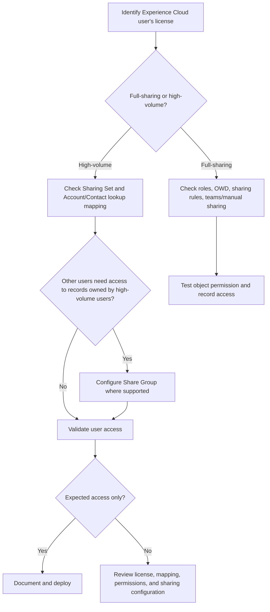

# 01.2 — How User Licenses Affect Sharing: Full Sharing vs High Volume

## 1. Your Original Content — Preserved

### 01.2 User Licenses ka Sharing pe Asar — Full Sharing vs High Volume

When designing sharing, it is important to check the **license type**, because not every license supports the same sharing model.

🔑

Experience Cloud (Community) has two paths:

- **Standard community users** → normal **Sharing Rules** work (they have roles).
- **High-volume users** → use **Sharing Sets** and **Share Groups**.

### Comparison shown in the source image

| License Group | Examples | Sharing Model |
|---|---|---|
| **Full Sharing Model** | Salesforce (core), Knowledge Only, Lightning Platform / Platform, Force.com | Full model — Roles, Sharing Rules, Manual Sharing, and Teams are available. |
| **High Volume** | High Volume Customer Portal / High Volume Community users | No roles. They cannot be used in standard Sharing Rules. Access is based on foreign-key matching — i.e., **Sharing Sets**. |
| **Chatter** | Chatter Free, Chatter External | No access to CRM records, so record sharing is not needed. |

## 2. Current Salesforce Status — 19 October 2026

- **High-volume Experience Cloud users do not use roles**, so the standard role hierarchy and normal role-based sharing model do not apply to them. Current Salesforce documentation lists External Apps, Customer Community, High Volume Customer Portal, and Authenticated Website among high-volume license examples. [Official Salesforce Help](https://help.salesforce.com/s/articleView?id=platform.networks_about_hvpu.htm&language=en_US&type=5).
- **Sharing Sets** grant access by matching a user’s Account or Contact relationship with lookups on target records. Example: providing access to Cases related to the Account identified through the user’s Contact. [Create a Sharing Set](https://help.salesforce.com/s/articleView?id=005131340&language=en_US&type=1).
- **Share Groups** allow records owned by high-volume users to be shared with selected authenticated internal/external users. Share Groups are not used for guest users; guest-user sharing rules are relevant for that scenario. [Use Share Groups](https://help.salesforce.com/s/articleView?id=sf.networks_sharing_light_users.htm&language=en_US&type=5).
- **Correction/clarification:** Saying “high-volume users only use Sharing Sets” is incomplete. Sharing Sets provide high-volume users access to matching records; Share Groups allow other eligible users to access records owned by high-volume users.
- **Chatter Free / Chatter External:** Salesforce Architects’ sharing architecture overview says these licenses do not provide standard/custom CRM record access or the standard sharing model. Verify exact capabilities against current license documentation and your org’s entitlements. [Salesforce Architects — Platform Sharing Architecture](https://architect.salesforce.com/docs/architect/fundamentals/guide/platform-sharing-architecture.html).

## 3. Important Additional Points — Compact Table

| Extra point | Short explanation | Why it matters |
|---|---|---|
| **Sharing Set ≠ Share Group** | A Sharing Set maps an external user to matching records; a Share Group lets selected users access records owned by high-volume users. | Prevents a common exam and implementation confusion. |
| **Verify the license first** | Sharing capabilities can differ by license, even for users on the same Experience Cloud site. | The wrong sharing design can leave users without required records. |
| **Do not assume high-volume users fit standard role/group sharing** | High-volume users are not eligible for roles/public groups and some standard sharing features. | Keeps architecture and troubleshooting accurate. |

## 4. Interview Questions & Answers

**Q1. What is the main difference between a full-sharing user and a high-volume user?**  
**Answer:** Full-sharing users can use roles, the role hierarchy, and standard sharing mechanisms, subject to license and object support. High-volume Experience Cloud users do not have roles; their record access uses mechanisms such as Sharing Sets and, where needed, Share Groups.

**Q2. How does a Sharing Set work?**  
**Answer:** A Sharing Set matches the user’s Account or Contact relationship with a lookup relationship on a target record. When the mapping matches, the configured access level grants record access.

**Q3. What is the difference between a Sharing Set and a Share Group?**  
**Answer:** A Sharing Set gives high-volume site users access to matching records. A Share Group shares records owned by high-volume users with selected authenticated internal/external users.

**Q4. Can high-volume users be included in normal owner-based sharing rules?**  
**Answer:** Generally, no. Salesforce documentation says high-volume Experience Cloud users do not have roles and are not supported as normal sharing-rule recipients. Check current license-specific documentation for supported sharing mechanisms.

**Q5. A customer portal user needs to see Cases related to their Account. What would you use?**  
**Answer:** If the user has a high-volume license, evaluate a Sharing Set with Contact/Account-to-Case mapping, then verify object permissions, external OWD, license capability, and negative access tests.

## 5. Simple Flow

## 6. Quick Summary

- **Full sharing:** roles and standard sharing mechanisms may be available, depending on license and object.
- **High volume:** no roles; Sharing Sets use Account/Contact relationship matching.
- **Share Groups:** share records owned by high-volume users with eligible authenticated users.
- **Chatter Free/External:** do not assume CRM record access.
- Always verify the exact license and current Salesforce documentation before designing sharing.

## 7. Official References

1. [About High-Volume Community or Site Users](https://help.salesforce.com/s/articleView?id=platform.networks_about_hvpu.htm&language=en_US&type=5)
2. [Create a Sharing Set for Experience Cloud Site Users](https://help.salesforce.com/s/articleView?id=005131340&language=en_US&type=1)
3. [Use Share Groups to Share Records Owned by High-Volume Experience Cloud Site Users](https://help.salesforce.com/s/articleView?id=sf.networks_sharing_light_users.htm&language=en_US&type=5)
4. [Salesforce Architects — Platform Sharing Architecture](https://architect.salesforce.com/docs/architect/fundamentals/guide/platform-sharing-architecture.html)
