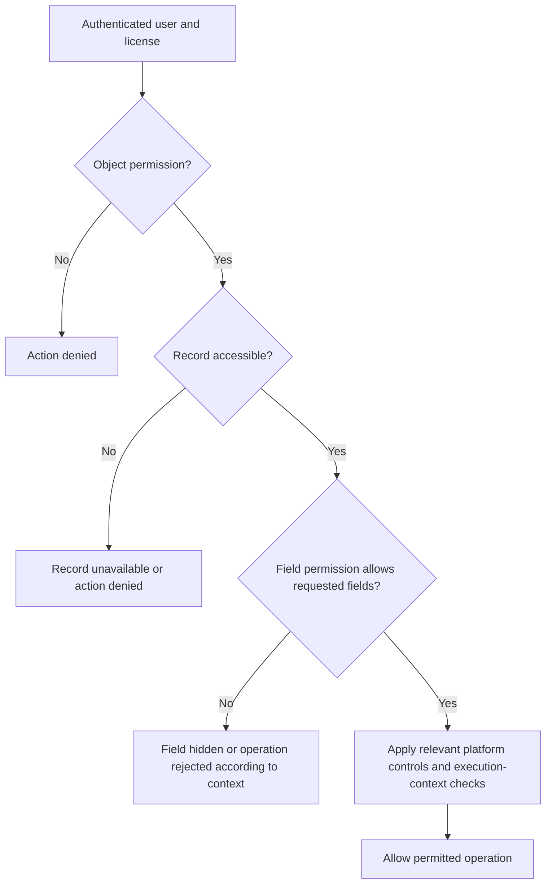
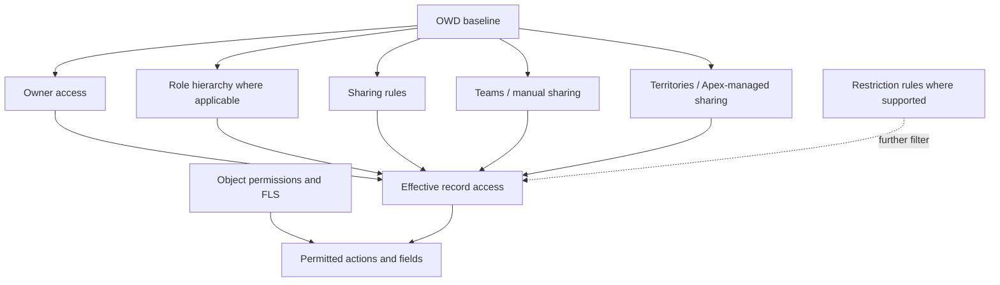
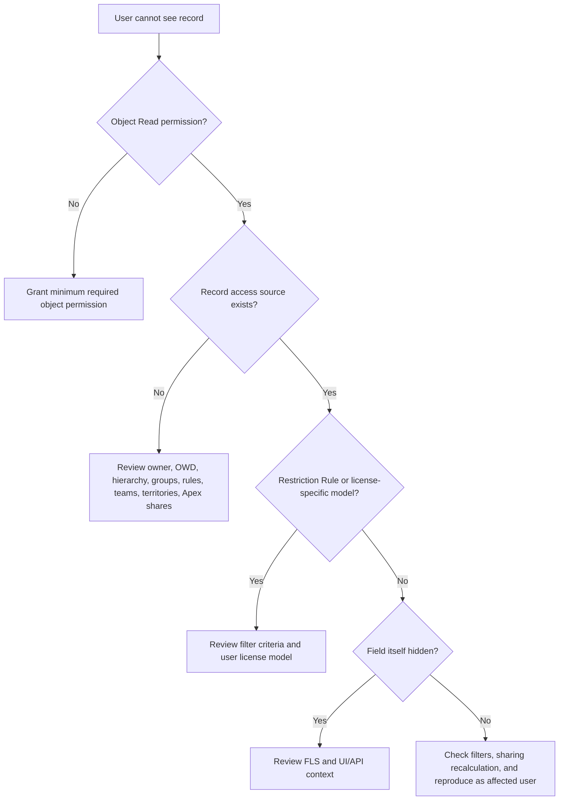

# Platform App Builder — Salesforce Fundamentals
# Sharing & Visibility — Who Can See Which Records and How (OWD, Roles, Profiles, Permission Sets, Teams)

**Section:** Session 2 — Sharing & Visibility  
**Prepared:** 19 October 2026  
**Audience:** Salesforce Platform App Builder, Administrator, Developer, Consultant, and Sharing & Visibility Designer candidates

> **Scope note:** The source heading identifies this as “Session 2,” so `02` is used as the section identifier in the filenames. If the course uses a different official section number, the filename can be renamed accordingly.

## 1. Learning Objectives

After this section, you should be able to:
- Explain the four access layers: organization access defaults, object access, field access, and record access.
- Distinguish object permissions (CRED), Field-Level Security (FLS), OWD, Role Hierarchy, Sharing Rules, Teams, and Queues.
- Diagnose why a user cannot see a record or cannot edit/delete it.
- Explain record ownership and how Master-Detail relationships relate to `Controlled by Parent`.
- Design a sharing model based on current Salesforce documentation.
- Answer scenario-based Platform App Builder and architecture interview questions.

## 2. Original Source — Preserved

> Preservation note: The supplied source is preserved below in the same sequence. The input contains an empty table/header fragment and some standalone emoji/blank areas; their missing content has not been guessed or inserted into the original. The source mentions “7 scenario-based solutions” at the end of its introduction, but those seven scenarios were not included in the pasted text. They have therefore not been invented as original content; relevant practice scenarios are provided separately in the expert-added sections.

# Sharing & Visibility — Record Access Kaun Dekhega aur Kaise (OWD, Roles, Profiles, Permission Sets, Teams)

This session covers the largest chunk of the **Salesforce Fundamentals** section of the Platform App Builder exam — **Sharing and Visibility**. The exam mainly asks about four things: **Org access defaults, Object access, Field access, and Record (data) access**. Here we will break down each layer step by step in Hinglish, understand the logic behind real screens, and solve seven scenario-based solutions at the end — which will also provide a solid foundation for the Sharing & Visibility Designer certification.

**Platform App BuilderSalesforce FundamentalsSharing & VisibilitySession 2**

## 01.1Sharing Architecture ka Foundation — Har Record ka ek Owner hota hai

In Salesforce, **data access always starts with a user**. Remember the first rule:

🔑

**Golden Rule:** Every record must have a **single User** or a **Queue** as its owner. A record cannot exist without an owner.

In a Master-Detail relationship, the owner field is not displayed on the child record—but an owner exists conceptually, and access is **inherited from the parent** (`Controlled by Parent`).

### Access ki Layers — neeche se upar (progressive unlocking)

Salesforce's model is: **lock everything down first (most restrictive), then open access as needed**. Each higher layer only **adds** access; it does not **remove** it.

🧭

**Profiles & Permission Sets** operate **separately alongside** these layers. They determine what a user can do with an **object and its fields** (CRED). They do not decide “which record”; they decide “what can be done with that record.”

### Do alag sawaal — confuse mat hona

|   |
| - |

💡

**Exam trick:** If the record itself is not visible, having “Delete” checked in the Profile is of no use. Both conditions must be satisfied **at the same time**.

## 3. Topic-by-Topic Detailed Explanation

### 3.1 The four access questions

Understand Salesforce access through four separate questions:

| Layer | Main question | Common controls | Example |
|---|---|---|---|
| Organization baseline | What is the default access to other users’ records in the org? | OWD, internal/external defaults | Accounts Private |
| Object-level | What actions can the user perform on the object? | Profile, Permission Set, Permission Set Group | Account Read + Edit |
| Field-level | Which fields can the user read/edit? | Field-Level Security (FLS), field permissions | Salary field hidden |
| Record-level | Which individual records can the user access? | Ownership, OWD, role hierarchy, sharing rules, teams, manual/Apex sharing, territories, restriction rules | Rep sees only assigned accounts |

**Important:** These layers are not interchangeable. Sharing a record does not create missing object permissions; object Read permission does not automatically expose every record; and field permissions are not a substitute for record-level access.

### 3.2 Object permissions — CRED

CRED stands for:
- **C — Create:** Can create a new record for the object.
- **R — Read:** Can read records the user is allowed to access.
- **E — Edit:** Can update an accessible record.
- **D — Delete:** Can delete an accessible record.

Additional object permissions can include `View All` and `Modify All`. These object-specific permissions can bypass ordinary record-sharing restrictions for that object. `View All Data` and `Modify All Data` are broader org-wide administrative permissions and should be assigned according to least privilege.

### 3.3 Field-Level Security (FLS)

FLS determines whether a user can read or edit a field’s value. For example, a user may be able to access an Account record while the `AnnualRevenue` field is hidden or read-only.

- Object Read and field readability are separate checks.
- Editing a field also requires the relevant object/record edit capability.
- Hiding a field on a page layout is not a substitute for FLS. Use field permissions for sensitive fields.
- Verify security enforcement in API, reports, list views, and custom code contexts. Apex execution context and choices such as `WITH SECURITY_ENFORCED` or user-mode query/DML affect implementation.

### 3.4 OWD — Organization-Wide Defaults

OWD defines baseline record access for records users do not own. A security design generally starts with the most restrictive workable baseline and opens access through sharing where necessary.

Common access levels (availability varies by object):
- **Private:** The owner and users with access through permitted sharing/administrative mechanisms.
- **Public Read Only:** Users can read records, but editing requires ownership or additional edit access/object permission.
- **Public Read/Write:** Users can view and edit records, subject to object permissions and other controls.
- **Controlled by Parent:** Access to a child record is controlled by access to the parent; this is typical Master-Detail behavior.
- Additional access levels can exist for particular objects. Not every option is available for every object.

For supported objects, internal and external users can have separate OWD settings. Review external-user access independently.

### 3.5 Record ownership and queues

Every normal Salesforce record has a single owner, either a User or, on supported objects, a Queue. A Queue is a shared work bucket; queue membership and supported queue access help users claim records or manage workloads.

Record ownership does not mean that object permissions can be ignored. For example, a user with Create and Read but not Edit/Delete can create and view a record but cannot edit or delete it.

**Master-Detail nuance:** A detail-side record has no independent owner field. Its access is controlled by the master record’s access/ownership model. Do not confuse this with a Lookup relationship: a lookup does not generally make the child inherit the parent’s owner automatically.

### 3.6 Role hierarchy vs role vs profile

- A **Role** primarily contributes to record-level visibility through the role hierarchy.
- A **Profile** configures baseline permissions and user settings; every user has exactly one profile.
- A **Permission Set** grants additional permissions; a user can have multiple permission sets.
- A **Permission Set Group** bundles related permission sets.
- Users in the same role are not automatically guaranteed access to each other’s records.
- The role hierarchy does not have to be an exact copy of the HR organization chart; design roles around data-access needs.

### 3.7 Sharing mechanisms

| Mechanism | Best fit | Key caution |
|---|---|---|
| OWD | Baseline record access | Avoid an unnecessarily broad baseline |
| Role hierarchy | Managers accessing subordinate records | Does not automatically provide peer access |
| Owner-based sharing rule | Access based on owner/role/group | Adds access |
| Criteria-based sharing rule | Records matching field criteria | Consider criteria changes and recalculation |
| Public group | Reusable group of sharing recipients | Membership alone does not grant record access |
| Manual sharing | One-off record collaboration | A manual share can be removed when ownership changes |
| Account/Opportunity/Case teams | Record-specific collaboration on supported objects | Team membership and share access must be maintained |
| Enterprise Territory Management | Territory-based/matrix sales coverage | Role and territory models may both need management |
| Apex managed sharing | Declarative sharing is insufficient | Design lifecycle, share reason, bulk processing, and ownership changes |
| Restriction rules | Further filtering of existing access | Check supported objects/features and edition limits |

Sharing rules extend access; they are not designed to make access more restrictive than OWD. Restriction Rules are an important additional control that can further filter eligible records.

### 3.8 The exact meaning of “both conditions”

An action on a record is possible only when the relevant permission and access checks are satisfied:
1. The user has the required object permission.
2. The user has the required access to that particular record.
3. If a field is being read or updated, field permissions allow it.
4. Applicable system permissions, restriction rules, license constraints, sharing behavior, and execution context must also be considered.

Simplified interview formula:

`Effective access = object permission + record access + field permission + applicable platform/security controls`

This is a conceptual formula, not a literal Salesforce calculation or API expression.

## 4. How It Works Internally

Salesforce determines effective access using multiple controls. One layer is not a substitute for another.

1. The user authenticates and makes a request within the scope of their license and enabled features.
2. Object permissions are checked: Read/Create/Edit/Delete, and so on.
3. The record-sharing model determines whether the user can access the specific record.
4. Field permissions determine whether the requested fields can be read or edited.
5. Additional controls—such as restriction rules, sharing exceptions, Apex execution mode, and CRUD/FLS enforcement—can affect the outcome.

### Access decision checklist

- No object Read permission? A record-sharing rule alone does not grant Read capability.
- Object Read exists, but no record share? The user may see other records on the object but not this particular record.
- Record is accessible but a field is hidden? The record can be available while the field value remains unavailable.
- `View All`/`Modify All` object permission exists? It can bypass record-sharing restrictions for that object; review its scope carefully.
- Is Apex running in system context? Sharing enforcement and CRUD/FLS enforcement are separate concerns; `with sharing` alone does not enforce CRUD/FLS.

## 5. Architecture and Data Flow



### Record access expansion model



These diagrams are conceptual. Exact platform evaluation varies by object, feature, license, and execution context.

## 6. Practical Salesforce Business Scenarios

1. **Sales reps should see only their own leads:** Set Leads OWD to Private; grant the required object Read permission; use the role hierarchy for managers; use carefully scoped sharing rules for cross-team visibility.
2. **All employees can read Accounts but only owners can edit:** Set Account OWD to Public Read Only and grant the required object Read/Edit permissions. Review owner access, other grants, and elevated permissions.
3. **A manager needs subordinate records:** Configure the role hierarchy; verify role assignments and object permissions. Do not assume users in the same role automatically share records.
4. **A support agent needs one Opportunity:** Consider an Opportunity Team or appropriate manual sharing, depending on the process and supported object.
5. **A confidential custom record must not roll up to a manager:** Verify whether the custom object’s OWD settings allow `Grant Access Using Hierarchies` to be disabled; test ownership, shares, and requirements carefully. This setting cannot be disabled for standard objects.
6. **Partner users should see only related customer records:** Verify external OWD, license model, sharing sets/share groups where applicable, Account/Contact relationships, and external sharing rules.
7. **A record is visible but Delete fails:** Check object Delete permission, record access, ownership, dependencies, validation/automation, and object-specific restrictions.

## 7. Implementation Examples

### 7.1 Setup-based implementation checklist

1. Map user personas and their data needs.
2. Define object CRUD and field read/edit requirements.
3. Set OWD to the most restrictive baseline that meets the business requirement.
4. Design roles for managerial visibility, not merely job titles.
5. Add owner-based or criteria-based sharing rules for recurring access patterns.
6. Use teams/manual sharing for record-specific collaboration.
7. Use Apex managed sharing only if declarative tools cannot meet the requirement.
8. Test positive and negative cases with representative users.
9. Review Login As (where permitted), record sharing details, permission assignments, debug logs, and access troubleshooting tools.
10. Plan bulk changes and OWD/role/group realignments in a sandbox and suitable maintenance window.

### 7.2 Apex example: sharing a custom object record

Illustrative pattern only. Assume custom object `Project__c` has a supported share table `Project__Share`, and the user has the necessary permissions to execute the operation. Confirm the object’s sharing configuration and API support in the target org.

```apex
Project__Share shareRow = new Project__Share();
shareRow.ParentId = projectRecordId;
shareRow.UserOrGroupId = targetUserOrGroupId;
shareRow.AccessLevel = 'Read';
shareRow.RowCause = Schema.Project__Share.RowCause.Manual;
insert shareRow;
```

**Gotchas:**
- `projectRecordId` and `targetUserOrGroupId` must be valid IDs of the expected types.
- This example uses manual sharing; manual shares can be removed when ownership changes.
- Custom Apex Sharing Reasons are available for custom objects and can make programmatic share lifecycle management clearer.
- Do not assume this exact code applies to every standard object or every org configuration.
- Handle bulk operations, duplicate shares, exceptions, and access verification in production code.

### 7.3 Querying with security in mind

In Apex, `with sharing` enforces record-level sharing for the class, but does **not by itself enforce object CRUD or FLS**. Choose user-mode operations or explicit CRUD/FLS checks appropriate to the use case and API version. Do not copy an old security pattern without validating current Apex documentation.

```apex
public with sharing class AccountReader {
    public static List<Account> getAccounts() {
        return [SELECT Id, Name FROM Account WITH USER_MODE LIMIT 100];
    }
}
```

This illustrates user-mode query intent. Verify syntax and behavior against the Apex version and current official documentation used by your org.

## 8. Current Salesforce Status — Verified 19 October 2026

### Update 1 — OWD remains the baseline, not the entire security model

- **Original Session Claim:** Access starts with a user; record access has a restrictive baseline and is opened as needed.
- **Current Salesforce Documentation:** Salesforce continues to describe OWD as the baseline for records users do not own, with sharing features extending access. Object and field permissions are configured separately. [OWD documentation](https://help.salesforce.com/s/articleView?id=sf.security_sharing_owd_about.htm&language=en_US&type=5) and [Control Who Sees What](https://help.salesforce.com/s/articleView?id=platform.security_data_access.htm&language=en_US).
- **Correction or Clarification:** “Each higher layer only adds access and never removes it” is a useful simplification for traditional sharing mechanisms, but it is not universally true for every modern control. Restriction Rules can further filter eligible records; object permissions and FLS remain separate gates.
- **Practical Impact:** Troubleshoot object permissions, record access, field permissions, and restriction rules separately.
- **Recommended Approach:** Build a user-persona access matrix and test both allowed and denied cases.

### Update 2 — Permission Sets and Permission Set Groups are the preferred permission-management pattern

- **Original Session Claim:** Profiles and Permission Sets control object and field capabilities.
- **Current Salesforce Documentation:** Salesforce recommends permission sets and permission set groups for managing permissions, with profiles retained for baseline settings. [Manage User Access](https://help.salesforce.com/s/articleView?id=xcloud.security_user_access_overview.htm&language=en_US&type=5).
- **Correction or Clarification:** Profiles have not become irrelevant; every user still has one profile. Permission sets grant additional permissions, and permission set groups bundle them.
- **Practical Impact:** Avoid profile proliferation when job functions differ by small combinations of permissions.
- **Recommended Approach:** Use a minimal set of profiles plus reusable permission sets/groups and a documented permission assignment process.

### Update 3 — Role hierarchy is not identical to an HR chart

- **Original Session Claim:** Role hierarchy contributes to record-level access.
- **Current Salesforce Documentation:** Salesforce Architects recommends modeling roles around data-access needs and notes that users in the same role do not automatically see one another’s records. [Platform Sharing Architecture](https://architect.salesforce.com/docs/architect/fundamentals/guide/platform-sharing-architecture).
- **Correction or Clarification:** Role hierarchy behavior differs for standard and custom objects. For custom objects, `Grant Access Using Hierarchies` can be configured; it is not a universal switch for every standard object.
- **Practical Impact:** A job title or same-role membership is not proof of record access.
- **Recommended Approach:** Design and test role branches against real data-access requirements.

### Update 4 — Sharing-model changes can be expensive

- **Original Session Claim:** Sharing architecture should be understood before changing access.
- **Current Salesforce Documentation:** Salesforce published guidance on 29 June 2026 warning that OWD changes, large role hierarchy changes, sharing-rule creation, and public-group maintenance can trigger recalculation, lock contention, and performance impacts. [Change Organization-Wide Sharing Settings](https://help.salesforce.com/s/articleView?id=000387251&language=en_US&type=1).
- **Correction or Clarification:** A configuration change can trigger broad recalculation; it is not always an instantaneous, low-risk change.
- **Practical Impact:** Large orgs can experience contention and lengthy access recalculations.
- **Recommended Approach:** Plan changes, test in a sandbox, coordinate deployments, and monitor performance.

### Update 5 — Ownership, queues, and large data volumes

- **Original Session Claim:** Each record has a single owner or queue.
- **Current Salesforce Documentation:** Salesforce Architects documents record ownership, queue usage, and a best practice for users owning more than 10,000 records: avoid placing that owner in the role hierarchy, or place the role at the top of a separate branch. [Platform Sharing Architecture](https://architect.salesforce.com/docs/architect/fundamentals/guide/platform-sharing-architecture).
- **Correction or Clarification:** Treat 10,000 as an architecture best-practice warning in the cited guidance, not as a universal hard record-ownership limit.
- **Practical Impact:** Ownership skew can make sharing recalculations slower.
- **Recommended Approach:** Avoid concentrating very large record volumes under a role-bearing user unless the architecture has been reviewed and tested.

## Additional Expert Points — Compact Table Only

| Extra point | Why it matters |
|---|---|
| **Troubleshoot object permissions, record access, and FLS separately.** | Prevents “fixing” a problem in one layer by granting unnecessarily broad access in another. |
| **Start with least privilege and restrictive OWD.** | Reduces unnecessary data exposure and privacy risk. |
| **Use reusable Permission Sets/Groups.** | Makes permissions easier to maintain, audit, and reuse. |
| **Run both positive and negative access tests.** | Confirms intended users can access records while unintended users remain blocked. |
| **Plan and stage large sharing changes.** | Reduces the risk of recalculation delays and performance impact. |

> **Scope control:** Expert additions are intentionally limited. The main detail focuses on your source content and verified Salesforce behavior.

## 14. Interview Questions and Answers

### Basic

**Q1. What are the four main layers of Salesforce data access?**  
**Answer:** Organization defaults, object permissions, field-level security, and record-level access. Object permissions control actions on an object, FLS controls fields, and record sharing controls which records are accessible.

**Q2. What is OWD?**  
**Answer:** Organization-Wide Defaults establish baseline access to records users do not own. OWD is generally set as restrictively as the business allows, and access is then opened through appropriate sharing mechanisms.

**Q3. What is the difference between Profile and Role?**  
**Answer:** A Profile configures baseline permissions and user settings. A Role primarily affects record visibility through the hierarchy and sharing. A role does not grant object CRUD permissions by itself.

**Q4. What does CRED stand for?**  
**Answer:** Create, Read, Edit, and Delete. These are object-level permissions and do not, by themselves, guarantee access to every record.

### Intermediate

**Q5. A user has Delete permission but cannot delete a record. Why?**  
**Answer:** Delete permission is only one condition. The user may lack access to the record, another control may restrict access, or dependencies, validation rules, automation, or object-specific constraints may prevent deletion. Check CRUD, record access, and the actual error.

**Q6. Two users have the same Profile and Role. Why might one see a record and the other not?**  
**Answer:** Their record ownership, sharing-rule group membership, team membership, manual shares, territory assignments, restriction rules, license model, or other access grants can differ. The same profile/role does not guarantee identical record access.

**Q7. Does a sharing rule restrict access?**  
**Answer:** Traditional sharing rules extend access beyond the OWD baseline; they are not designed to make access more restrictive. Restriction Rules, where supported, can further filter records a user can access.

**Q8. What happens to a manual share when record ownership changes?**  
**Answer:** Manual shares can be removed during ownership transfer. If access is still required, use a durable mechanism such as an appropriate sharing rule, team, territory, or correctly designed programmatic sharing.

### Advanced

**Q9. Explain `Controlled by Parent`.**  
**Answer:** For a detail record in a Master-Detail relationship, access is controlled by the master record. The detail record has no independent owner. A Lookup relationship generally does not behave this way automatically.

**Q10. What is the difference between `View All` and `View All Data`?**  
**Answer:** `View All` is object-specific and can bypass record-sharing restrictions for that object. `View All Data` is a broader system permission across org data. Grant the narrowest permission that meets the requirement.

**Q11. Does Apex `with sharing` enforce CRUD and FLS?**  
**Answer:** No. `with sharing` controls record-level sharing behavior. CRUD/FLS require separate enforcement, such as user-mode operations or explicit security checks. Select the pattern that fits the API version and intended execution context.

**Q12. Why can an OWD change be risky in a large org?**  
**Answer:** It can trigger broad sharing recalculations, lock contention, and performance impacts. Plan the change, test in a sandbox, assess ownership/data skew, and coordinate deployment.

### Super-Advanced / Architect Scenarios

**Q13. A user can see an Account but not its custom child record. What would you inspect?**  
**Answer:** First verify object Read permission on the child object. Then inspect child ownership/OWD, relationship type, role hierarchy behavior, sharing rules, teams/manual/Apex sharing, restriction rules, and license model. Do not assume Account visibility automatically grants access to every related custom record.

**Q14. A user sees a record but cannot see one sensitive field. Is sharing broken?**  
**Answer:** Not necessarily. Record access and FLS are separate. Verify field permissions and the UI/API context. Avoid “fixing” a field-visibility problem by broadening record access.

**Q15. The business wants a record visible to one ad-hoc collaborator, not the entire department. Which tool would you choose?**  
**Answer:** For supported records and a one-off requirement, consider a team or manual sharing. If the assignment must be durable, define how ownership changes and membership lifecycle are handled. Use Apex managed sharing only if native options do not meet the requirement.

**Q16. A user owns more than 10,000 records and role hierarchy changes are slow. What is your architectural response?**  
**Answer:** Treat this as possible ownership skew. Salesforce Architects recommends avoiding a role for such an owner or placing the role at the top of a separate branch where appropriate. Test changes at scale and plan sharing recalculation.

**Q17. How would you troubleshoot a record access complaint systematically?**  
**Answer:** Confirm object permission, identify record owner and user role, inspect OWD and hierarchy, then check sharing rules/groups, teams/manual shares, territories, Apex shares, and restriction rules. Finally examine FLS, filters, license-specific sharing, and recent recalculation activity.

**Q18. What is your secure design strategy for a new object?**  
**Answer:** Classify the data, define personas, map CRUD/FLS and record needs, choose the restrictive baseline, add the smallest sharing mechanisms that satisfy collaboration, evaluate restriction rules, test positive/negative scenarios, and document ownership/lifecycle behavior.

## 9. Success Paths, Failure Paths, and Troubleshooting

### If a user cannot see a record



### Troubleshooting checklist

- Confirm the user is active and has a compatible license.
- Confirm object Read permission through profile/permission sets/groups.
- Confirm record owner and object OWD.
- Check role hierarchy and whether the user is a superior, peer, or in a separate branch.
- Inspect sharing rules and their target public groups/roles/territories.
- Confirm team membership or manual sharing still exists.
- If using Apex managed sharing, inspect the code path and share records.
- Check restriction rules and external-user-specific sharing mechanisms.
- Check FLS if the record appears but a field is missing.
- If a configuration change was just made, allow for and monitor sharing recalculation.
- Review list-view filters, report filters, search behavior, and page-specific logic before concluding that sharing is the cause.

## 10. Security, Privacy, Permissions, and Governance

- Follow least privilege: grant only necessary object actions, fields, and records.
- Treat `View All`, `Modify All`, `View All Data`, and `Modify All Data` as high-impact permissions.
- Do not expose sensitive data through overly broad OWD or guest-user sharing rules.
- Separate internal and external user access where supported.
- Review access regularly, especially after role, team, territory, ownership, or employment changes.
- Test with realistic users, not only System Administrator.
- Use controlled deployment and documented approval for OWD and hierarchy changes.
- For regulated or sensitive data, validate API, reports, exports, integration, Apex execution mode, and audit requirements.
- Sharing is not encryption, consent management, or data retention; it is one part of the broader privacy/security model.

## 11. Limitations, Platform Limits, Licensing, and Gotchas

- Exact OWD options vary by object.
- Role support and sharing behavior vary by license type; high-volume external users can use different mechanisms such as sharing sets/share groups.
- Role hierarchy does not automatically grant peer-to-peer visibility.
- An Account parent-child hierarchy alone does not automatically share child Account records.
- Standard and custom objects can differ in hierarchy behavior.
- Manual shares can be removed when record ownership changes.
- A record owner does not automatically have every CRUD action; object permissions still matter.
- Object-level `View All`/`Modify All` can bypass ordinary record sharing for that object.
- Apex `with sharing` does not automatically enforce CRUD/FLS.
- OWD changes, group changes, and hierarchy realignments can trigger expensive recalculations.
- Limits and availability can change by release and edition; verify current object-specific documentation before deployment.

## 12. Advantages, Disadvantages, and Architecture Trade-offs

| Option | Advantages | Trade-offs / risks |
|---|---|---|
| Private OWD + sharing | Strong least-privilege baseline | More sharing configuration and troubleshooting |
| Public Read Only | Simple broad read access | May expose more data than required |
| Role hierarchy | Natural manager visibility | Deep/complex hierarchies can increase maintenance |
| Sharing rules | Declarative and scalable for repeatable patterns | Rules only add access; rule/group design needs governance |
| Teams/manual shares | Good for one-off collaboration | Ongoing membership management; manual shares can be lost on ownership transfer |
| Apex managed sharing | Flexible, dynamic control | Code complexity, testing, bulk/recalculation considerations |
| Restriction rules | Further limit eligible record visibility | Supported objects/features and edition limits apply |

## 13. Recommended Approach

1. Begin with a user-persona and data-classification matrix.
2. Set the most restrictive OWD that meets the business requirement.
3. Use permission sets and permission set groups for reusable object/FLS permissions.
4. Model role hierarchy for managerial access needs, not just job titles.
5. Use sharing rules for recurring, predictable sharing requirements.
6. Use teams or manual sharing for record-specific collaboration on supported objects.
7. Use territories for genuine territory-based or matrix sales access.
8. Use Apex managed sharing only when declarative controls cannot meet the requirement.
9. Evaluate restriction rules when users need a further record filter.
10. Test visibility and editability independently, including negative tests.
11. Plan large-scale sharing changes and ownership distributions for performance.

## Interview Questions and Answers

> **Scope control:** Expert additions are intentionally limited to the compact table above. Detailed coverage focuses on the source content and verified current Salesforce behavior.


## 15. Quick Summary

- OWD = baseline record access.
- Profile/Permission Set/Permission Set Group = object and field permissions.
- Role hierarchy = manager/subordinate record visibility, subject to object behavior.
- Sharing rules, teams, manual sharing, territories, and Apex sharing can extend access.
- Restriction Rules can further filter records where supported.
- Record access, object permission, and FLS are separate checks.
- Master-Detail detail records inherit parent-controlled access.
- The same profile or role does not guarantee identical record visibility.
- Large ownership and sharing changes need performance planning.

## 16. Key Takeaways

1. Ask separately: “Can the user access this object?”, “Can they access this record?”, and “Can they access this field?”
2. Prefer least privilege and a restrictive OWD baseline.
3. Prefer permission sets and permission set groups for scalable permission management.
4. Use each sharing mechanism for the requirement it was designed to solve.
5. Do not assume record relationships automatically grant record access.
6. Verify current object-specific and license-specific behavior before production changes.

## 17. Official Salesforce References

1. [Salesforce Architects — Platform Sharing Architecture](https://architect.salesforce.com/docs/architect/fundamentals/guide/platform-sharing-architecture)
2. [Salesforce Help — Organization-Wide Sharing Defaults](https://help.salesforce.com/s/articleView?id=sf.security_sharing_owd_about.htm&language=en_US&type=5)
3. [Salesforce Help — Control Who Sees What](https://help.salesforce.com/s/articleView?id=platform.security_data_access.htm&language=en_US)
4. [Salesforce Help — Manage User Access](https://help.salesforce.com/s/articleView?id=xcloud.security_user_access_overview.htm&language=en_US&type=5)
5. [Salesforce Help — Sharing and Record Access Features](https://help.salesforce.com/s/articleView?id=sf.managing_the_sharing_model.htm&language=en_US&type=5)
6. [Salesforce Help — Sharing Rules](https://help.salesforce.com/s/articleView?id=platform.security_about_sharing_rules.htm&language=en_US&type=5)
7. [Salesforce Help — Change Organization-Wide Sharing Settings (published 29 June 2026)](https://help.salesforce.com/s/articleView?id=000387251&language=en_US&type=1)

## 18. No-Skip Checklist

- [x] Original title and session labels preserved.
- [x] Original introductory paragraph preserved.
- [x] Original Golden Rule and ownership statement preserved.
- [x] Original Master-Detail / Controlled by Parent statement preserved.
- [x] Original progressive-unlocking concept preserved and clarified.
- [x] Original Profiles, Permission Sets, and CRED statement preserved.
- [x] Empty source table fragment explicitly identified rather than guessed.
- [x] Original exam trick preserved.
- [x] Current Salesforce status dated 19 October 2026 and sourced.
- [x] Architecture/data-flow diagrams included.
- [x] Success/failure troubleshooting included.
- [x] Interview Q&A from basic through architect level included.
- [ ] The source-mentioned seven scenario solutions were not supplied in the pasted source. Seven relevant practice scenarios have been added separately; they are not claimed to be the missing original scenarios.

## 19. Board-Level Answer

Salesforce access should be designed as a layered model. Object permissions determine which actions a user can perform, field-level security determines which fields are readable or editable, and record-level sharing determines which individual records the user can access. OWD provides the baseline; roles, sharing rules, teams, territories, and programmatic sharing provide controlled access where needed. A secure architecture uses least privilege, permission sets and permission set groups, tested sharing behavior, careful governance of high-impact permissions, and planned rollout of changes that can trigger large sharing recalculations.
