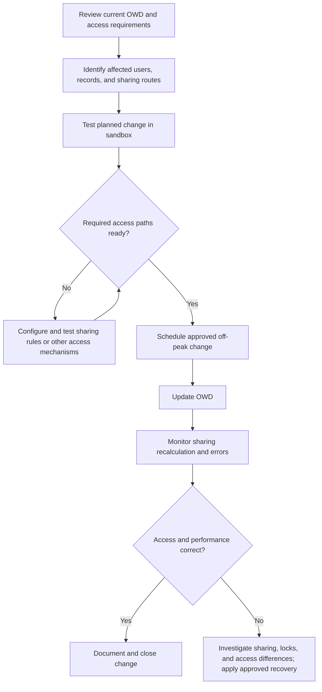

# Salesforce Sharing & Visibility — Session 2
# Section 01.3: Organization-Wide Defaults (OWD) — The Baseline Lock

## 1. Your Original Content — Preserved

### 01.3 Org-Wide Defaults (OWD) — Sabse Neeche ka Base Lock

OWD is available under Setup → **Sharing Settings**. It sets the **default (minimum) access level** for each object.

🔒

**Rule:** Set OWD to the **most restrictive** level the business requires. If data must be hidden from some users, set OWD to **Private**, then open access using sharing tools.

### Internal vs External Access

OWD has **two columns** — **Default Internal Access** (your employees) and **Default External Access** (Experience/Community users). External access can never be **more permissive** than internal access.

### Grant Access Using Hierarchies (third column)

- It means users **above the record owner in the role hierarchy automatically receive access**.
- For **standard objects**, it is always ON — **you cannot disable it**.
- For **custom objects**, you can uncheck it if managers should not automatically receive access.
- It also applies to users above members of roles, public groups, queues, and territories.

### Sharing Recalculation — Timing Matters

Whenever OWD changes, Salesforce **recalculates sharing**; the more data, the longer it can take.

⚠

**Real-world warning:** Don’t change OWD in the middle of the business day.
- With large data volumes, **record-lock errors** can occur and users may be unable to save.
- If you change OWD to **Private** before the sharing rules are ready, **access can be lost immediately** for users who no longer qualify.

**Best practice:** Prepare sharing rules first, then change OWD during off-hours / a maintenance window.

🎓

**Exam question:** “When should sharing recalculation be run?” → **Off-peak / after business hours**, because large data volumes can cause performance and locking issues.

## 2. Current Salesforce Status — 19 October 2026

| Topic | Current status / clarification |
|---|---|
| **OWD baseline** | Salesforce still recommends using OWD to establish a restrictive baseline and granting additional access through sharing tools where needed. [Salesforce Help](https://help.salesforce.com/s/articleView?id=sf.security_sharing_owd_about.htm&language=en_US&type=5) |
| **Internal vs External** | Separate internal and external defaults are supported. External access must be at least as restrictive as internal access; it cannot be more permissive. [External OWD](https://help.salesforce.com/s/articleView?id=sf.security_owd_external.htm&language=en_US&type=5) |
| **Grant Access Using Hierarchies** | For eligible custom objects, this can be unchecked (except when access is Controlled by Parent). For standard objects, the option is generally enabled and cannot be changed through OWD settings, although object-specific exceptions/settings exist. Avoid saying it is literally ON for every standard object without qualification. [Role Hierarchy](https://help.salesforce.com/s/articleView?id=sf.security_controlling_access_using_hierarchies.htm&language=en_US&release=234.16.0&type=5) |
| **Queue nuance in 2026** | Summer ’26 introduces a queue-level **Grant Access Using Hierarchies** setting: existing queues keep it enabled by default; new queues have it disabled by default. This is separate from the custom-object OWD checkbox. [Salesforce Admins — Summer ’26](https://admin.salesforce.com/blog/2026/jens-top-summer-26-release-features-for-admins) |
| **Recalculation** | OWD changes trigger sharing recalculation. Large orgs can take a long time; Salesforce recommends planning sharing changes to reduce performance and locking risk. [Salesforce Architects](https://architect.salesforce.com/docs/architect/fundamentals/guide/platform-sharing-architecture.html) |
| **Access timing** | Don’t assume every access change waits for recalculation to finish. Salesforce documents that increasing default access can take effect immediately while recalculation runs asynchronously to clean up redundant sharing. Plan and verify the exact change. [Security Implementation Guide](https://resources.docs.salesforce.com/206/latest/en-us/sfdc/pdf/salesforce_security_impl_guide.pdf) |

## 3. Important Additional Points — Compact Table

| Extra point | Explanation | Why it matters |
|---|---|---|
| **OWD does not grant CRUD/FLS** | Users still need object permissions and field access. | OWD alone does not mean users can perform every action or access every field. |
| **Prepare access before tightening OWD** | Map required users and sharing routes, then test the planned change in a sandbox. | Reduces accidental access loss and production disruption. |
| **Validate the exact hierarchy control** | The custom-object OWD hierarchy setting and the newer queue-level setting are different controls. | Prevents changing the wrong setting while troubleshooting access. |

## 4. Interview Q&A

**Q1. What is OWD?**  
OWD sets baseline record access for records users do not own. Use the most restrictive baseline that meets the business requirement, then grant additional access selectively.

**Q2. Can external OWD be more permissive than internal OWD?**  
No. External access must be at least as restrictive as internal access.

**Q3. Can `Grant Access Using Hierarchies` be disabled for a standard object?**  
Generally, it cannot be changed through the standard OWD setting for standard objects. Eligible custom objects support disabling it, subject to relationship/configuration constraints. Check object-specific exceptions.

**Q4. What happens when OWD changes?**  
Salesforce recalculates record sharing. Duration depends on org size and sharing complexity; some default-access changes take effect before asynchronous cleanup finishes.

**Q5. Why schedule major OWD changes off-peak?**  
Large recalculations can consume resources, cause lock contention, and affect users’ ability to save records. Off-peak timing reduces disruption but does not replace sandbox testing and rollout planning.

## 5. Flow — Safe OWD Change

## 6. Quick Summary

- OWD is the record-access baseline; start with the most restrictive workable setting.
- Internal and external defaults are separate; external access cannot be more permissive.
- The hierarchy checkbox is configurable for eligible custom objects; queue hierarchy access has a separate queue-level setting in Summer ’26.
- OWD changes trigger sharing recalculation, which can take time in large orgs.
- Prepare sharing paths, test in a sandbox, and schedule major changes off-peak.

## 7. Official References

1. [Salesforce Help — Organization-Wide Sharing Defaults](https://help.salesforce.com/s/articleView?id=sf.security_sharing_owd_about.htm&language=en_US&type=5)
2. [Salesforce Help — External Organization-Wide Defaults](https://help.salesforce.com/s/articleView?id=sf.security_owd_external.htm&language=en_US&type=5)
3. [Salesforce Help — Controlling Access Using the Role Hierarchy](https://help.salesforce.com/s/articleView?id=sf.security_controlling_access_using_hierarchies.htm&language=en_US&release=234.16.0&type=5)
4. [Salesforce Architects — Platform Sharing Architecture](https://architect.salesforce.com/docs/architect/fundamentals/guide/platform-sharing-architecture.html)
5. [Salesforce Admins — Summer ’26 Release Features](https://admin.salesforce.com/blog/2026/jens-top-summer-26-release-features-for-admins)
