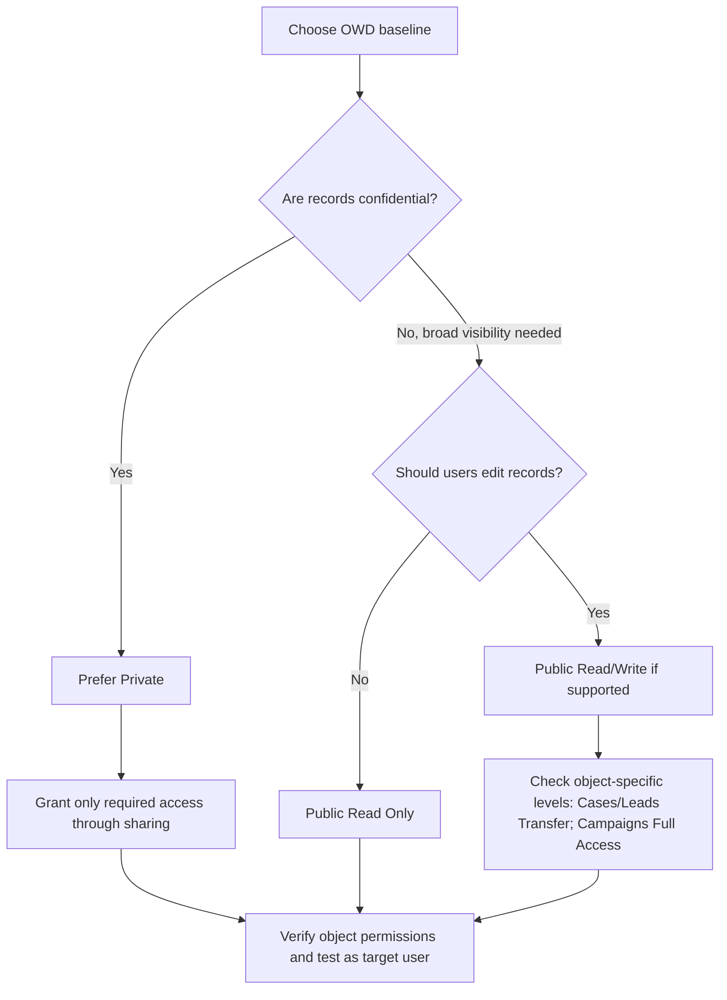

# Salesforce Sharing & Visibility — Session 2, Section 01.4
## OWD Access Levels — From Private to Public Full Access (and the Reporting Twist)

## 1. Original Content — Preserved

### OWD access levels

| Access Level | What users can do | Availability |
|---|---|---|
| **Private** | The record owner and users above the owner in the role hierarchy can view, edit, and report on the record. | Most restrictive; most objects |
| **Public Read Only** | Users can view and report on records but cannot edit them. The owner and users above the owner in the hierarchy can edit them. | Most objects |
| **Public Read/Write** | Users can view, edit, and report on records. | Most objects |
| **Public Read/Write/Transfer** | Users can view, edit, transfer ownership, and report on records. | Cases and Leads only |
| **Public Full Access** | Users can view, edit, transfer, delete, and report on records. | Campaigns only |
| **Controlled by Parent** | Access to a child record depends on access to its parent record. | Default for master-detail relationships; can also be an OWD option in applicable cases |

### The reporting twist

**Public Read Only** means users cannot edit records, but they can view and report on records they can access. Therefore, Read Only is not sufficient when records are confidential; use **Private** as the baseline and grant access deliberately.

### Special OWD — Price Book 💵

Price Book access levels:
- **Use:** Users can view price books and use them on Opportunities to add products.
- **View Only:** Users can view and report on price books. To use a price book on an Opportunity, they may need the applicable Opportunity Edit permission or explicitly granted Use access.
- **No Access:** Users cannot see or use price books through this OWD level, subject to permissions that independently grant access.

### Special OWD — User 👤

User object options:
- **Private:** Users can read their own user record; they may also be able to read records of users below them in the role hierarchy.
- **Public Read Only:** Users can read one another’s user records. User details can also appear in lookups, list views, search, and ownership operations.

---

## 2. Current Salesforce Clarifications (checked October 2026)

- OWD defines **baseline record-level access**. Profile and Permission Set object permissions (Read, Edit, Delete, etc.) are a separate layer; OWD does not grant object permissions by itself. [Salesforce: OWD overview](https://help.salesforce.com/s/articleView?id=sf.security_sharing_owd_about.htm&language=en_US&type=5)
- Do not interpret **Private** as “only the owner and manager” in every situation. Additional access can be granted through permissions, sharing rules/manual sharing, and other applicable sharing mechanisms. Salesforce administrators with broad permissions may also have access. [Salesforce: OWD access levels](https://help.salesforce.com/s/articleView?id=sharing_model_fields.htm&language=en_US&type=5)
- With **Public Read Only**, users can view/report on records they can access, but they still need the relevant object and reporting permissions. Reporting access does not mean edit access.
- **Public Read/Write/Transfer** is available as an OWD level only for **Cases and Leads**; **Public Full Access** is available only for **Campaigns**. [Salesforce: OWD access levels](https://help.salesforce.com/s/articleView?id=sharing_model_fields.htm&language=en_US&type=5)
- **Price Books** have distinct `Use`, `View Only`, and `No Access` OWD levels. Important exception: Salesforce’s June 21, 2026 known-issue article says users with **Edit permission on Price Books** can access all Price Books even when the OWD is `No Access`. If this restriction is required, review the Price Books Edit permission in both Profiles and Permission Sets. [Salesforce Known Issue/Resolution](https://help.salesforce.com/s/articleView?id=000386177&language=en_US&type=1)
- **User OWD Private** is not a complete description if phrased as “only your own user record”: users can have read access to records of users below them in the role hierarchy, and the `View All Users` permission can override sharing settings. [Salesforce: User OWD](https://help.salesforce.com/s/articleView?id=platform.security_sharing_owd_users.htm&language=en_US&type=5) · [User sharing considerations](https://help.salesforce.com/s/articleView?id=security_sharing_users_concept.htm&language=en_US&type=0)

## 3. Useful Extra Points

| Point | Explanation | Why It Matters |
|---|---|---|
| OWD vs. object permissions | OWD controls *which records* are available; object permissions control *which actions* are allowed on the object. | Both layers must be checked when troubleshooting access. |
| Read-only is not confidential | Public Read Only makes records broadly visible/reportable. | For sensitive records, consider a Private baseline and deliberate sharing. |
| Price Book permission exception | `Edit` on Price Books can grant access beyond the apparent OWD restriction. | Review both Profiles and Permission Sets during least-privilege audits. |

## 4. Interview Q&A

**Q1. Can a user create/use a report with Public Read Only?**  
Yes. The user can view and report on records they can access, but this OWD level does not let them edit those records. Relevant report and object permissions still apply.

**Q2. Why is Public Read Only insufficient for confidential records?**  
Because users can view and report on the records. A Private baseline with need-based sharing is more appropriate for confidential data.

**Q3. Which objects support Public Read/Write/Transfer?**  
Cases and Leads.

**Q4. Which object supports Public Full Access?**  
Campaigns.

**Q5. Price Book OWD is No Access, but a user can still see price books. Why?**  
The user may have `Edit` permission on Price Books through a Profile or Permission Set, which can grant access to all Price Books. Verify that permission.

**Q6. Does the role hierarchy matter when User OWD is Private?**  
Yes. Users can have read access to user records below them in the hierarchy; permissions such as `View All Users` can also affect visibility.

## 5. Quick Decision Flow

## 6. Quick Summary

- **Private:** restrictive baseline; additional sharing or permissions may still grant access.
- **Public Read Only:** users can view/report on accessible records but cannot edit them through this access level.
- **Public Read/Write:** users can view/edit records, subject to object permissions.
- **Public Read/Write/Transfer:** Cases and Leads only.
- **Public Full Access:** Campaigns only.
- **Controlled by Parent:** child-record access follows parent-record access.
- **Price Book:** `Use`, `View Only`, and `No Access`; check the `Edit` permission if No Access appears ineffective.
- **User:** Private can still allow some hierarchy-based visibility; `View All Users` is another consideration.

## 7. Official References

1. [Organization-Wide Default Access Settings](https://help.salesforce.com/s/articleView?id=sharing_model_fields.htm&language=en_US&type=5)
2. [Organization-Wide Sharing Defaults](https://help.salesforce.com/s/articleView?id=sf.security_sharing_owd_about.htm&language=en_US&type=5)
3. [User OWD settings](https://help.salesforce.com/s/articleView?id=platform.security_sharing_owd_users.htm&language=en_US&type=5)
4. [User Sharing Considerations](https://help.salesforce.com/s/articleView?id=security_sharing_users_concept.htm&language=en_US&type=0)
5. [Price Book access known issue/resolution (June 2026)](https://help.salesforce.com/s/articleView?id=000386177&language=en_US&type=1)
