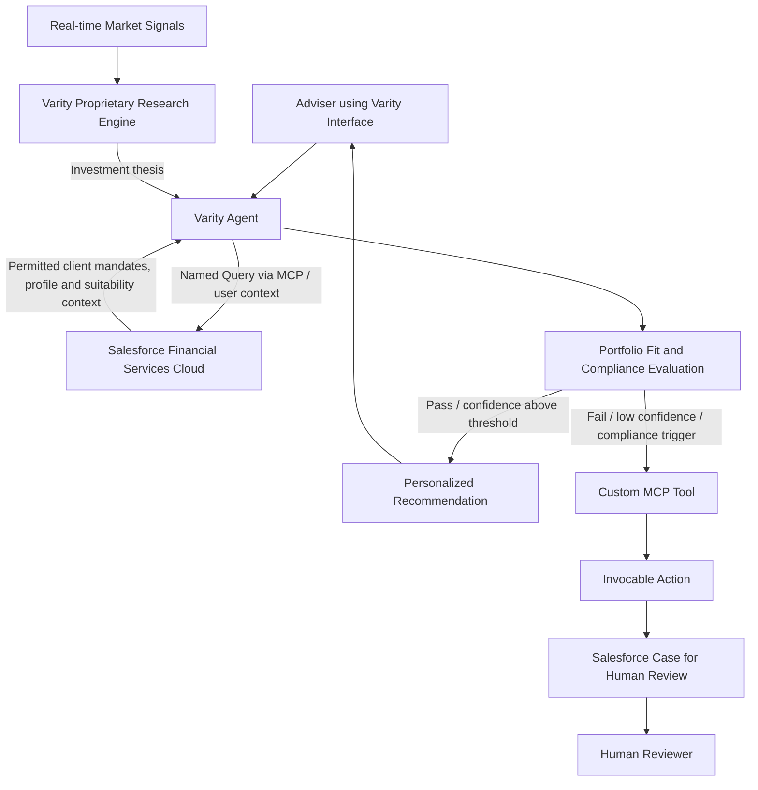

# Think Like an Architect — Episode 5
## Design an AI-Native Architecture with Headless 360

> **Source:** User-provided transcript  
> **Episode topic:** Headless 360 / AI-native architecture  
> **Scenario:** Varity, an AI-native fintech startup, builds personalized investment research for independent financial advisers.  
> **Preservation note:** The complete source transcript is reproduced verbatim at the end of this file. ASR errors, repetitions, wording, timestamps, and the closing portions are intentionally not silently corrected.

---

# Part I — Architecture Walkthrough

## 1. Executive overview

Episode 5 designs an AI-native architecture for Varity, a fintech startup that provides personalized investment research to independent financial advisers.

Varity owns:
- Real-time market-signal ingestion.
- A proprietary research engine that generates investment theses.
- Its agentic system and adviser-facing interface.
- Proprietary matching logic for portfolio fit.

Salesforce Financial Services Cloud (FSC) stores the client context needed for the decision, including mandates, financial profiles, holdings and suitability constraints.

The architecture keeps proprietary reasoning in Varity, uses MCP to expose narrowly scoped Salesforce capabilities to the Varity Agent, and creates a Salesforce Case when compliance or portfolio-fit thresholds require human review.

## 2. Business requirements — WHAT

### 2.1 Scenario interpretation

| Business statement | Architectural implication |
|---|---|
| Varity is an AI-native fintech startup | Existing agents and MCP-oriented patterns may be relevant; this is context, not proof of a specific implementation |
| A proprietary engine generates investment theses from real-time market signals | Keep market research and thesis generation within Varity's proprietary boundary |
| Theses must be matched against client mandates, holdings and suitability constraints in Salesforce | Retrieve only the required client context from Salesforce FSC |
| Recommendations must appear through Varity's own interface | Do not force the Salesforce UI into the adviser experience |
| The happy path should not require human intervention | Automate the normal path while retaining policy controls and auditability |
| Compliance constraints or low portfolio-fit confidence require escalation | Route exceptions to a human reviewer |
| Escalations must be logged in Salesforce with context | Use a Salesforce work record; the episode selects Case |

### 2.2 Distilled high-level requirements

1. Ingest real-time market signals and generate a raw investment thesis.
2. Retrieve client mandates, holdings and suitability constraints from Salesforce.
3. Evaluate the thesis against client context for portfolio fit and compliance.
4. Surface a personalized recommendation through Varity's own adviser interface.
5. Escalate to a human reviewer and log context in Salesforce when fit or compliance thresholds are not met.

## 3. Architecture decisions — HOW

### 3.1 Preserve the proprietary research boundary

The research engine is treated as a black box. The architecture needs to know its integration boundary and input/output contract, not its internal implementation.

- Market signals enter the Varity research engine.
- The engine produces an investment thesis.
- Matching rules can remain in Varity because they are proprietary.
- Reimplementing the matching logic in Salesforce could duplicate business rules and create unnecessary data movement.

**Architectural lesson:** Integrate with proprietary systems through clear contracts. Do not migrate their intellectual property without a business reason.

### 3.2 Agentforce versus MCP for Salesforce data retrieval

The architect considers Agentforce, then tests the requirement:
- Is natural-language understanding required?
- Is reasoning or instruction following required?
- Or is the requirement simply to retrieve known, structured data?

The episode concludes that structured retrieval does not require a reasoning agent. It selects Headless 360 / MCP capabilities for the data-access requirement.

### 3.3 SObject Reads versus Named Queries

**Risk of broad SObject Reads in this scenario:**
- The agent may be able to read objects and fields available to the authenticated user.
- The exposed data surface may be broader than the business requirement.
- Sensitive financial holdings could be exposed unnecessarily.

**Episode decision: Named Queries**

A Named Query is a predefined, named query contract. The architect controls:
- The object or objects queried.
- The fields returned.
- The selection and filtering logic.
- The business-facing name and description presented to the agent.

This gives the agent a focused business query rather than unrestricted query construction.

**Illustrative SOQL only:**

```sql
SELECT Id, Name, Risk_Profile__c, Investment_Objective__c
FROM Financial_Profile__c
WHERE Adviser__c = :currentUserId
```

This is conceptual illustration, not a claim about the exact supported Named Query syntax or binding behavior in every release. Validate the target org's current documentation for query syntax, bind variables, filtering, authorization and MCP exposure.

**Episode decision guide:**
- Repetitive, well-defined business question → Named Query.
- Exploratory / flexible querying → SObject Reads, provided permissions and data exposure are acceptable.
- The agent should do less than the user → Named Query or a narrow custom tool is a strong governance pattern.

### 3.4 Integration identity — service account versus user context

Two patterns are discussed:

| Pattern | Meaning | Benefit | Risk / trade-off |
|---|---|---|---|
| Integration user / client credentials | The application runs as a designated integration user | Stable system-to-system identity and centralized administration | A broadly privileged shared identity can weaken adviser-level isolation |
| Named user / user context | The interaction runs in the authenticated adviser's context | Aligns access with the adviser's permissions and record visibility | OAuth lifecycle, provisioning, revocation and runtime context must be managed |

**Episode decision:** Use user context because an adviser must not see another adviser's customer profiles.

**Important distinction:** Do not treat an OAuth scope or MCP connection permission as the complete data authorization boundary. Actual access depends on the authenticated principal, Salesforce permissions, sharing, field-level security, object access and the design of exposed tools.

### 3.5 Where should matching happen?

The episode keeps matching in Varity's proprietary engine:
- Retrieve the required client context from Salesforce.
- Send that context to the Varity Agent / engine.
- Evaluate the research thesis using Varity's proprietary matching process.
- Return the match result and rationale to the Varity Agent.

**Rationale:** Duplicating matching rules in Salesforce could create duplicated IP, synchronization overhead and unnecessary data movement.

### 3.6 Varity Agent as the orchestration layer

The Varity Agent:
1. Receives the adviser request.
2. Retrieves permitted client context through the Salesforce MCP capability.
3. Calls the Varity research engine for the thesis / market research.
4. Coordinates portfolio-fit and compliance evaluation.
5. Surfaces a recommendation through Varity's own adviser interface when the happy path succeeds.
6. Triggers escalation when no match is found, confidence is low or compliance thresholds fail.

Salesforce Agentforce is not selected as the primary agent because the core orchestration and proprietary IP already live in Varity. Agentforce could still become relevant as a distribution or experience layer if future requirements call for the Varity Agent to be accessed through Slack, Teams, a website, mobile or other surfaces.

### 3.7 Human escalation — Salesforce Case and custom MCP capability

The episode's design:
- The Varity Agent decides that escalation is required.
- A Salesforce Case is created in FSC.
- The Case contains context and the reason a human reviewer must inspect the decision.
- A custom MCP server capability is exposed instead of granting broad SObject Mutations.
- The custom capability invokes an Invocable Action to perform the narrowly defined Case-creation operation.

**Why not broad SObject Mutations?** The agent should not receive arbitrary write access to every object the user can access. The episode uses customer holdings as an example: the agent should not autonomously sell portfolio shares simply because it has a write-capable connection.

**Design principle:** Expose a purpose-built operation such as `Create Compliance Review Case`, not unrestricted generic record mutation.

## 4. End-to-end architecture flow



This is a simplified representation of the episode's design. The transcript does not fully specify transport, hosting, API contracts, retry strategy, data minimization or transaction boundaries.

## 5. WHY — Decision log and trade-offs

| Decision | Rationale | Alternative considered | Trade-off |
|---|---|---|---|
| Retain Varity research engine | Proprietary IP and rules remain with Varity | Duplicate logic in Salesforce | External dependency remains, but duplication is avoided |
| MCP / Headless access for structured reads | Agent-oriented, described capabilities; no reasoning agent needed for simple retrieval | Agentforce agent / direct REST | MCP adds semantic tool context; REST may be simpler for deterministic integration |
| Named Queries | Restrict fields and query scope | Broad SObject Reads | Less flexible, stronger least-privilege design |
| User context | Adviser should see only permitted customer records | Shared integration user | Better user-level security; more OAuth lifecycle complexity |
| Varity Agent orchestration | Existing proprietary agent and logic remain in place | Salesforce Agentforce orchestration | Retains existing IP; distributed operations need robust monitoring |
| Salesforce Case | Human-review work item and escalation record | Custom object / external queue | Standard Case capabilities may help; validate the case model |
| Custom MCP + Invocable Action | Expose only the approved escalation write | Broad SObject Mutations | More implementation work, narrower write surface |

---

# Part II — Headless, MCP and Governance Concepts

## 6. API-first versus Headless

- **API-first:** Platform capabilities are exposed through APIs. The client must understand endpoints, payloads and business logic.
- **Headless:** The business capability is decoupled from a specific presentation layer. Different clients, agents and surfaces can consume the same governed capability.
- **Headless 360 (episode-era terminology):** Salesforce's vision of exposing platform capabilities through APIs, MCP tools, CLI commands and experiences so agents and applications can work across different surfaces.
- **AIforce (current naming):** Salesforce release notes state that Headless 360 was rebranded to AIforce on 4 September 2026. Headless Toolkit provides functionality to implement the vision. Older announcements and documentation may still use Headless 360.

## 7. Surfaces and experiences

- **Surface:** Where the user or agent works — Salesforce UI, Slack, Teams, mobile, website, voice, WhatsApp or an AI client.
- **Experience:** The interaction delivered on that surface — a text response, card, approval, workflow, rich UI or action.

Headless architecture separates the business capability from the surface through which it is consumed.

## 8. What is MCP?

**MCP = Model Context Protocol.** It is an open protocol for standardized interaction between an AI client / agent and external systems.

The episode identifies three important building blocks:
- **Tools:** Actions an agent can invoke.
- **Resources:** Contextual data or resources an agent can read.
- **Prompts:** Reusable instructions or prompt templates.

Compared with a raw API endpoint, an MCP tool can include a semantic name, description and input/output schema. This gives the agent context about what the capability does.

**MCP is not an authorization replacement.** It standardizes the capability interface. Identity, permissions, data filtering, approvals, audit and policy enforcement remain separate requirements.

## 9. MCP server versus REST API

| Dimension | REST API | MCP server |
|---|---|---|
| Primary interface | Endpoints, HTTP methods and payloads | Tools, resources and prompts |
| Typical consumer | Applications and developers | MCP-aware clients and agents as well |
| Discovery | API documentation, OpenAPI and integration code | Tool discovery and descriptions |
| Semantics | Defined in the contract; client interprets it | Tool name, description and schema provide agent context |
| Governance | API gateway, OAuth, application logic and platform permissions | MCP authentication, server controls and underlying platform permissions |
| Good fit | Deterministic service integrations and broad ecosystem support | Agent discovery and standardized tool interaction |

MCP does not automatically replace REST. REST remains a valid choice for deterministic integrations. MCP is useful when an agent benefits from capability discovery, semantic descriptions and standardized tool interaction.

## 10. Security and governance

### 10.1 External Client App

The episode describes the External Client App (ECA) as the identity bridge between an external MCP client and Salesforce.

- OAuth configuration and scopes help establish the client connection.
- Authentication establishes the identity under which the request runs.
- Actual object, record and field access depends on Salesforce permissions and the exposed MCP operations.
- Client secrets must be protected, rotated and replaced if compromised.

### 10.2 Named user versus integration user

**Named user / authorization-code style:** The operation is associated with a real user; that user's permissions and sharing model are relevant.

**Client credentials / integration user:** The application runs as a designated integration user. Salesforce documentation says the client-credentials flow requires an integration user. Anyone holding the relevant client credentials may be able to obtain a token, so secret management is critical.

**Architect caution:** The episode discusses OAuth flow names conversationally. Verify the supported flow, ECA configuration, principal semantics and token behavior for the exact Salesforce MCP product and release. Do not assume every MCP connection uses the same OAuth flow.

### 10.3 Least privilege for agents

A human user may need broad access for their job, but an agent does not automatically need every capability available to that user.

Layered controls:
1. User object permissions / CRUD.
2. Field-Level Security.
3. Record sharing, ownership and role access.
4. Narrow agent-facing tool allow-list.
5. Named Queries for limited read fields and rows.
6. Custom MCP tools / Invocable Actions for narrow writes.
7. Human approval for high-impact actions.
8. Audit, monitoring, alerting and incident response.

### 10.4 Sensitive-data and exfiltration risk

The Q&A considers a user taking Salesforce credentials or configuration and using a personal public AI model or cloud desktop to retrieve PII.

The episode discusses:
- Monitoring login history and anomalous login behavior through Event Monitoring.
- Evaluating Shield Event Monitoring and Transaction Security Policies.
- Providing sanctioned AI tools with approved retention and training terms.
- Restricting ordinary users from creating External Client Apps or other privileged configurations.
- Narrowing agent tools.
- Testing user and agent access boundaries.

**Reality check:** A sanctioned AI pathway does not eliminate exfiltration risk. Combine DLP, endpoint controls, session controls, OAuth policies, credential protection, data classification, monitoring, user training and incident response.

---

# Part III — Episode Q&A

## 11. Consolidated questions and answers

### Q1. Salesforce has always been API-first. What changed with Headless?

API-first means APIs are available. The broader Headless shift makes agents first-class consumers and exposes Salesforce capabilities through MCP tools, resources, prompts and experiences across different surfaces — not only browser UIs.

### Q2. What does MCP offer over a traditional API?

An API exposes endpoints. MCP can expose semantic tools, descriptions, schemas, resources and prompts. This helps an agent discover and select capabilities. MCP does not replace authorization.

### Q3. Why not give the agent unrestricted SOQL or broad SObject Read access?

Broad queries may expose unnecessary objects and fields. A Named Query constrains a known business question, selected fields and filter logic. Agent-specific access can be narrower than the human user's access.

### Q4. What role does an External Client App play?

It participates in OAuth client identity and connection setup. After authentication, data access is governed by the authenticated principal's Salesforce permissions and the exposed MCP operations. The ECA alone is not the complete authorization model.

### Q5. Can Slack connect to Salesforce MCP?

The episode's answer was affirmative in direction, but detailed setup and a demo were outside the session's scope. Verify the current Salesforce MCP client/server documentation and Slack support status before implementation.

### Q6. Why Headless / MCP instead of native Agentforce?

Varity already owns its agent and proprietary IP. Exposing Salesforce capabilities to that agent avoids unnecessarily replacing its existing orchestration. Agentforce remains a strong option for Salesforce-native agents, customer-support use cases and cross-surface distribution.

### Q7. Why not call REST APIs directly?

REST is a valid alternative. MCP adds agent-friendly semantic discovery and structured tool contracts. In a financial-services context, Salesforce-native governance, audit and platform controls were also part of the rationale. The final decision depends on use case and operating constraints.

### Q8. How should agent QA work?

Test two dimensions:
- **Behavioral correctness:** Does the agent select the right tool, respect guardrails and escalate correctly?
- **Answer quality:** Is the recommendation useful, consistent, grounded and accurate enough?

Include normal, edge, adversarial, ambiguous, permission-denied, stale-data, timeout and duplicate-request cases. Maintain regression evaluations as prompts and models change. Exact string matching alone is insufficient for probabilistic outputs.

### Q9. When should Named Queries be used instead of SObject Reads?

Use Named Queries for repetitive, well-defined business questions and when the agent should have less access than the user. Use SObject Reads for exploration when the access model and data exposure are acceptable. Tool descriptions should clearly explain when the agent should use each operation.

### Q10. What can replace MCP?

REST APIs, Apex REST, Flow, platform APIs, middleware and custom connectors. MCP is not mandatory; use it when an MCP-aware agent benefits from discovery and semantic capability contracts.

### Q11. How should a traditional Salesforce org prepare for Headless architecture?

Pilot agent experiences, identify data and process gaps, formalize repeated actions in Flow / Apex / APIs, clarify permissions and ownership, and retain rich UI where it remains valuable. Make common data and actions discoverable.

### Q12. How can sensitive Salesforce data be protected from use in a personal AI model?

Combine login anomaly monitoring, Event Monitoring, Transaction Security, approved AI pathways, restricted admin permissions, data classification, least privilege, DLP and audit. Do not claim that any single control eliminates the risk.

### Q13. How can an agent be blocked from a sensitive object when the human user can access it?

Control the human user's access with permission sets, sharing and FLS. Separately restrict the agent through the exposed tools, Named Queries, custom actions and allowed operations. Configure standard MCP operations with least privilege as well.

---

# Part IV — Additional Production Architecture Recommendations

> The following recommendations extend beyond the exact transcript and should be validated against the business, security and regulatory context.

## 12. Define contracts before implementation

| Contract | Minimum details |
|---|---|
| Salesforce read contract | Named Query name, fields, filters, user context, null handling and data freshness |
| Research engine contract | Input schema, thesis ID, model/version, source timestamps and output schema |
| Evaluation contract | Suitability ruleset version, confidence threshold, compliance result and reason codes |
| Escalation contract | Case fields, priority, owner/queue, idempotency key and evidence references |
| Recommendation contract | Recommendation ID, status, rationale, expiry and adviser/customer identifiers |

## 13. Separate high-impact capabilities

- Episode Case creation and customer portfolio trade execution are different capabilities.
- Separate read, recommend, create-review-Case and execute-trade tools / permission boundaries.
- Trade execution requires explicit human approval, policy checks, transaction limits, idempotency, audit trail and rollback / compensation planning.
- A recommendation must not imply permission to execute a transaction.

## 14. Reliability and failure handling

| Failure | Recommended response |
|---|---|
| Salesforce read timeout | Bounded retry with backoff; never label stale context as fresh |
| Duplicate escalation request | Idempotency key and duplicate detection |
| Research engine unavailable | Fail closed for compliance-sensitive recommendations; queue/retry where appropriate |
| Missing suitability fields | Do not infer; route for human review |
| Missing user context | Reject the request; never silently fall back to a privileged shared user |
| Compliance rules changed | Persist the ruleset version used for the decision |
| Case creation failed | Durable retry / dead-letter handling and alerting |
| Prompt injection | Treat retrieved text as untrusted; use tool allow-lists and server-side validation |

## 15. Observability and audit fields

Recommended correlation fields:
- `Correlation_Id__c`
- `Recommendation_Id__c`
- `Research_Thesis_Id__c`
- `Adviser_User_Id__c`
- `Customer_Record_Id__c`
- `Ruleset_Version__c`
- `Model_Version__c`
- `Confidence_Score__c`
- `Compliance_Status__c`
- `Escalation_Reason__c`
- `Source_Data_As_Of__c`

Avoid storing unnecessary raw PII or complete prompts in logs. Apply retention, masking and access controls.

---

# Part V — 2026 Salesforce Updates

## 16. Current status as of 5 November 2026

This section is based on external Salesforce documentation and announcements, separate from the episode transcript. Product names, beta/GA status, licensing and availability can change. Validate the target org and contract before implementation.

| Topic | Episode-era framing | Current documented position |
|---|---|---|
| Product name | Headless 360 | Salesforce release notes say Headless 360 was rebranded to **AIforce** on 4 September 2026. Headless Toolkit provides implementation functionality. |
| Hosted Headless 360 MCP server | Headless 360 / MCP concept | Current developer docs label the Headless 360 MCP Server **Beta**. Documented prerequisites include API v67.0+, an External Client App with `mcp_api` scope and an OAuth-configured MCP client. |
| Server tools | MCP tools described generally | Current server docs describe four core tools: Discover, Describe, Dispatch and Dispatch (Read-Only). |
| Named Query | Predefined SOQL query exposed as an agent tool | Salesforce REST API docs describe creating Named Query APIs in Setup, validating SOQL and obtaining the endpoint. The description is included in the OpenAPI document and helps agents understand when to select the action. |
| Custom MCP tools | Standard and custom MCP capabilities | Hosted MCP documentation lists Apex Invocable Actions, `@AuraEnabled` methods, Apex REST methods, Flows and Named Queries as ways to expose custom tools. |
| External identity | External Client App, named user / integration user | Client-credentials flow requires a specified integration user. Named-user OAuth flows use the user's identity. Select the supported flow for the exact product and connection type. |
| MCP usage billing | Not central to the episode | Hosted MCP overview warns that usage may be billed through Flex Credits. Confirm current commercial terms. |
| Headless surfaces / ecosystem | Slack, Teams, ChatGPT and other surfaces discussed | Salesforce's August 2026 expansion announcement describes capabilities across clouds, Data 360 MCP, Slack integrations, skills and headless experience capabilities. Availability varies by product. |
| Agent registration | Governance discussed at a high level | A September 2026 Salesforce Help article described planned November security controls, agent registration and billing changes. Treat them as planned until current org documentation confirms rollout / GA. |

### 16.1 Official documentation

1. [AIforce / Headless 360 release notes (Winter ’27)](https://help.salesforce.com/s/articleView?id=release-notes.rn_headless360.htm&language=en_US&release=264&type=5)
2. [Headless 360 MCP Server reference (Beta)](https://developer.salesforce.com/docs/platform/hosted-mcp-servers/guide/headless-360-mcp.html)
3. [MCP solutions for headless development](https://developer.salesforce.com/docs/platform/headless-get-started/guide/headless-mcp.html)
4. [Create Named Query APIs in Setup](https://developer.salesforce.com/docs/platform/api-rest/guide/resources-named-query-setup.html)
5. [Hosted MCP Servers overview](https://developer.salesforce.com/docs/platform/hosted-mcp-servers/guide/hosted-mcp-servers-overview.html)
6. [SObject Reads reference](https://developer.salesforce.com/docs/platform/hosted-mcp-servers/guide/sobject-reads.html)
7. [External Client App — Client Credentials Flow](https://help.salesforce.com/s/articleView?id=sf.meta_configure_client_credentials_flow_for_external_client_apps.htm&language=en_US&type=5)
8. [Salesforce announcement: Headless 360 expansion, August 2026](https://www.salesforce.com/news/stories/expanding-headless-360-enterprise-capabilities/)

### 16.2 Corrections and implementation cautions

- The episode's Headless 360 naming is historical / episode-era terminology; current Salesforce release notes use AIforce.
- Do not turn the episode's ECA and OAuth explanation into a universal authorization rule. Verify the exact server docs, OAuth flow, user principal and tool-level controls.
- Do not treat a Named Query as a complete security boundary. Validate authenticated identity, object permissions, FLS, sharing, filters and data minimization.
- A custom MCP tool backed by an Invocable Action is a sensible narrow write design, but idempotency, authorization, validation, error handling and audit must be enforced server-side.
- The episode is a design exercise. It does not specify production SLAs, throughput, detailed schemas, licensing, deployment topology or regulatory sign-off.
- “No human intervention on the happy path” does not mean bypassing compliance controls. Financial recommendations and trade execution are separate actions.

---

# Part VI — Interview Preparation

## 17. Interview-ready architecture answer

“I would keep Varity's proprietary market research and matching logic within Varity, while Salesforce FSC remains the governed source of adviser and client context. The Varity Agent orchestrates the journey and retrieves only the required data through a Named Query exposed over MCP in the authenticated adviser's context. This avoids broad SObject reads and preserves adviser-level access.

The agent sends the minimum required context to the Varity research engine, evaluates portfolio fit and compliance, and surfaces a recommendation in Varity's interface. If a threshold fails, it invokes a purpose-built custom MCP action backed by an Invocable Action to create a Salesforce Case for human review. I would not expose generic SObject mutations or trade execution. I would add server-side authorization, idempotency, audit, observability, failure handling and explicit human controls, then validate the current AIforce / Headless Toolkit release and licensing before deployment.”

## 18. Common interview follow-ups

1. Why Named Query instead of SObject Reads?
2. Does MCP replace REST APIs? No.
3. Does the `mcp_api` OAuth scope alone guarantee row-level security? No.
4. What is the difference between named user and integration user?
5. How do you prevent an adviser from seeing another adviser's records?
6. How can an agent have less access than a user?
7. Why use Case for human escalation?
8. Why not expose generic SObject Mutations?
9. What happens if Salesforce is unavailable after the agent decides to escalate?
10. How do you prevent duplicate Cases?
11. How do you prove which data and ruleset generated a recommendation?
12. Which actions require human approval?
13. When is Agentforce preferable to an external agent?
14. When is direct REST preferable to MCP?
15. What changes when Headless 360 is referred to as AIforce?

## 19. Quick revision summary

- Varity is an AI-native fintech with a proprietary research engine, agent and adviser interface.
- Salesforce FSC stores client mandates, financial profiles and suitability context.
- The Varity Agent is the orchestration layer.
- MCP standardizes agent interaction with tools, resources and prompts.
- Named Queries provide narrow, reusable business queries.
- User context preserves adviser-specific access.
- Custom MCP + Invocable Action provides a narrow Salesforce write for escalation.
- Salesforce Case is the human-review work item.
- Avoid unrestricted SObject mutations and accidental trade authority.
- Headless decouples business capabilities from a specific UI surface.
- Current naming: AIforce; Headless Toolkit provides implementation functionality. Verify release status and availability.

## 20. No-Skip Checklist

- [x] Episode introduction and experts
- [x] Headless 360 vision and API-first comparison
- [x] WHAT / HOW / WHY approach
- [x] Varity business requirements
- [x] Proprietary market research engine
- [x] Salesforce FSC data retrieval
- [x] Agentforce versus MCP reasoning
- [x] SObject Reads versus Named Queries
- [x] Named user versus integration user / user context
- [x] Portfolio-fit and compliance evaluation
- [x] Varity Agent orchestration
- [x] Salesforce Case escalation
- [x] SObject Mutations versus custom MCP + Invocable Action
- [x] MCP tools, resources and prompts
- [x] REST API comparison
- [x] Slack / surfaces discussion
- [x] Agent QA and probabilistic behavior
- [x] Named Query decision guide
- [x] Migration / readiness advice
- [x] Sensitive-data exfiltration and monitoring
- [x] Sensitive object restrictions
- [x] 2026 naming and documentation update
- [x] Additional production recommendations
- [x] Complete original transcript appended below

## 21. Board-level answer — one minute

“Keep proprietary AI reasoning and research inside Varity. Use Salesforce FSC as the governed source of adviser/customer context. Let the Varity Agent orchestrate the journey, but expose only a Named Query through MCP in the authenticated adviser's context. Return the minimum required data to Varity's research engine, evaluate suitability and compliance there, and show recommendations in Varity's interface. For exceptions, expose one custom MCP action backed by an Invocable Action to create a Salesforce Case for human review. Do not grant broad SObject mutations or trade execution. Enforce least privilege, idempotency, audit, observability and explicit human controls. Validate current AIforce / Headless Toolkit release status and licensing before rollout.”

---

