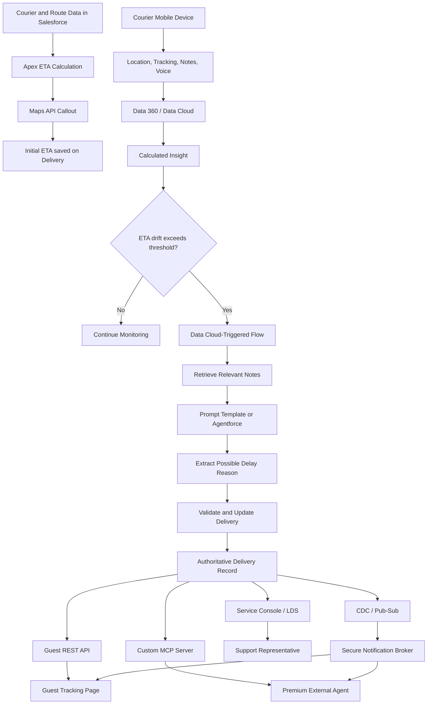
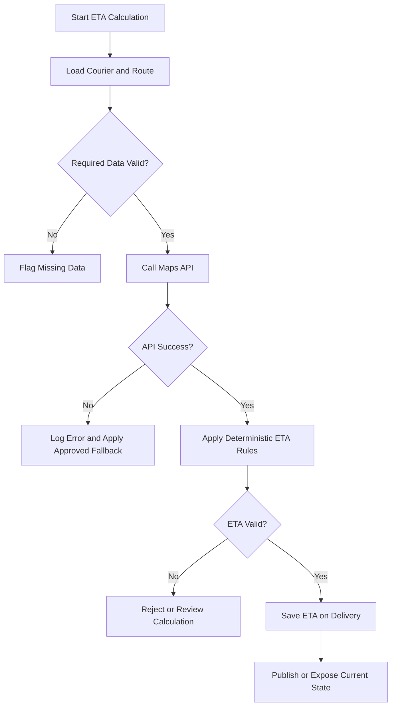
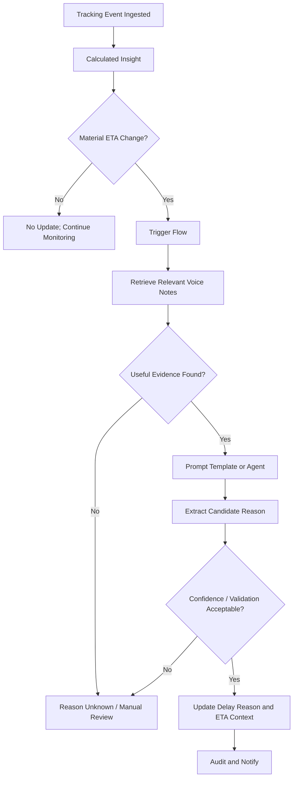
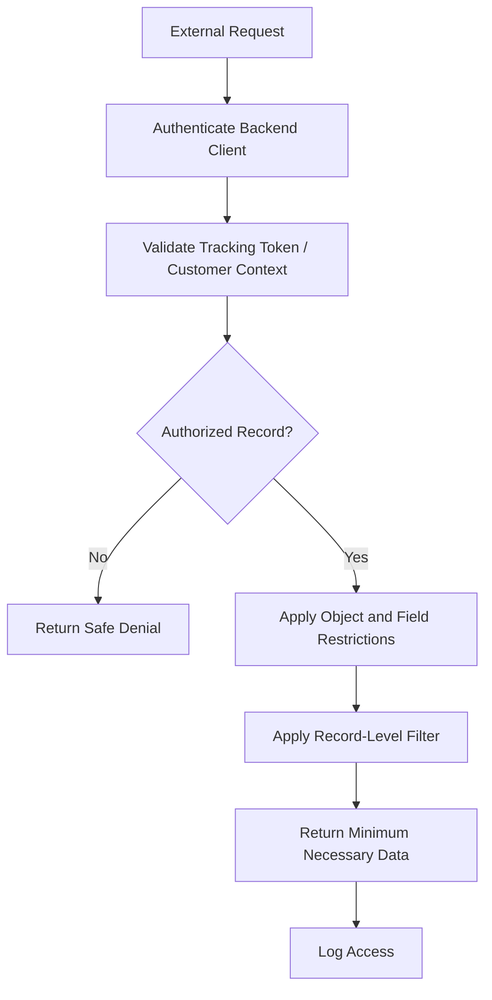

# Think Like an Architect: Exposing Deterministic Logic with a Headless Toolkit
## Complete English Learning Notes — Zero to Architect Level

> **Document rule:** The original transcript is preserved separately in the appendix. Explanations, architectural interpretation, recommendations, and additional technical knowledge are clearly separated. Apparent speech-to-text errors are not silently corrected in the preserved transcript. Product names and status claims must be checked against current Salesforce documentation before being treated as current capabilities.

# Part A — Session overview

## 1. Context, speakers, and agenda

The session uses a Halloween/zombie theme. Host Liz Vanbiza introduces herself as Principal Architect Evangelist at Salesforce and a CTA. Her guests are Ross Belmont, Senior Director of Product Management, and Shelley Susa, Lead Technical Architect.

The topic is **“Think Like an Architect — Exposing Deterministic Logic with a Headless Toolkit.”**

Agenda:
1. Explain the What / How / Why approach.
2. Apply it to a specific business challenge.
3. Identify requirements, assumptions, decisions, and diagram the architecture.
4. Invite audience questions and discuss them with the experts.

The host also gives the standard forward-looking statement: purchasing decisions should be based on products and services that are currently available. This disclaimer is not itself a product roadmap commitment.

### Learning point
An architecture presentation should not begin with a list of products. An architect first understands the problem, aligns stakeholders, and communicates the solution through diagrams and explicit decisions.

## 2. Think Like an Architect — WHAT / HOW / WHY

### 2.1 WHAT — What is the requirement?
- Read the business requirement carefully.
- Identify actors, business goals, constraints, and keywords.
- Convert natural-language requirements into clear high-level requirements.
- Clarify ambiguous terms such as “reliable,” “real-time,” “secure,” and “same” with measurable definitions.

### 2.2 HOW — How will we solve it?
- Break the requirement into smaller problems.
- Ask questions.
- Document assumptions explicitly; do not treat assumptions as facts.
- Make technical decisions.
- Diagram relevant components and interactions.
- Identify trade-offs for each decision.

### 2.3 WHY — Why this design?
- Explain why each component or pattern was selected.
- Explain why alternatives were not selected.
- Describe security, cost, complexity, maintainability, and scalability impacts.
- Record decisions in an Architecture Decision Record (ADR).

The host says that after the What/How/Why process, the design decisions should be justified and the ingredients for an ADR should be available. An ADR records context, decision, consequences, and alternatives—not just the final answer.

## 3. Business challenge — Undead Express

Undead Express is a fictional parcel-delivery company using zombie couriers. The zombie theme is fictional; the underlying architecture challenge is a realistic logistics/field-service problem.

### 3.1 Business facts and actors
1. Zombie couriers deliver parcels.
2. The delivery date is produced by a fixed calculation.
3. Inputs include courier shuffle speed, maximum range, condition score, and route.
4. Guest users see delivery status on an external tracking page after dispatch.
5. Premium customers ask a third-party external agent (“haunted mirror”) for the parcel ETA.
6. Support agents currently guess the date from a spreadsheet exported from Salesforce.
7. The business wants guest users, premium customers, and support representatives to see the **same reliable delivery date/time**.

### 3.2 High-level requirements
**Requirement 1:** Calculate and retain a reliable delivery date/time and capture a possible delay reason.

**Requirement 2:** Surface delivery information through:
- External tracking page.
- Premium customer's third-party mirror agent.
- Internal Service Console.

**Requirement 3:** Ensure each audience sees only the information it needs:
- Guest user.
- Premium customer.
- Support representative.

### 3.3 Grouping requirements
The presenter solves the first requirement separately because it involves the calculation, tracking, data processing, and delay-reason puzzle. She groups requirements 2 and 3 because each interface maps to a particular audience. This is a useful technique for decomposing and grouping requirements.

# Part B — Requirement 1: Reliable delivery date/time

## 4. Assumption 1 — ETA has two stages

The architect assumes that reliable ETA is a two-stage process.

### Stage A: Initial ETA — before dispatch
The initial ETA is based on the delivery route and courier data:
- Courier shuffle speed.
- Courier maximum range.
- Courier condition score.
- Delivery route and stops.
- Travel-time estimates from a mapping/routing service.

### Stage B: Updated ETA — while the courier is travelling
After dispatch, real-world tracking data is used to update the ETA. Courier condition or speed may change, and the route may encounter delays.

**Remember the difference:** Initial ETA is a planning estimate. Updated ETA is an operational estimate based on telemetry. Maintaining both through one authoritative Delivery record helps preserve consistency.

## 5. Assumption 2 — The calculation is complex

A route contains multiple deliveries/stops. A mapping/routing service may be needed to estimate arrival times at each point.

The presenter gives a Google Maps API callout as an example:
1. Read route/courier inputs from Salesforce.
2. Call the external mapping service for route/travel estimates.
3. Combine the returned estimates with business rules.
4. Calculate the delivery ETA.

**Caution:** A mapping API response is not automatically a guaranteed delivery promise. Traffic, route changes, API latency, quotas, stale location data, courier-specific constraints, and business buffers must be considered.

## 6. Decision — Use Apex to calculate the initial ETA

The session's decision:
- Apex reads courier data and delivery route.
- Apex calls the Google Maps API.
- Apex calculates the ETA.
- The result is saved in a Date/Time field on the Delivery record.

### Simplified conceptual data model

| Record/entity | Example fields | Purpose |
|---|---|---|
| Courier | Shuffle speed, condition score, maximum range | Courier capability |
| Delivery Route | Route, stops, sequence | Planned journey |
| Delivery | Courier, route, ETA, status, delay reason | Delivery-level source of truth |

This is a conceptual model; the transcript does not specify exact Salesforce object API names.

### Apex design considerations
- Callout timeouts and exception handling.
- API authentication and secret management.
- Governor and callout limits.
- Bulk processing; avoid unbounded callouts in loops.
- Retry strategy and idempotency.
- Store calculation timestamp, source, and rule/version when auditability matters.
- Handle mapping-service outages with an approved fallback estimate.
- Separate route estimation from business-rule calculation for testability.

## 7. Hybrid process diagram versus system landscape

The presenter explicitly says the diagram is not a traditional complete system landscape. It is a **hybrid process diagram** showing only relevant components and process steps. It does not attempt to include every possible component, such as a full integration layer.

The diagram includes:
- Service Cloud records.
- Apex logic.
- Google Maps API.
- Data movement and calculation.

**Architectural lesson:** Choose a diagram's scope based on the audience and question. A process diagram and a detailed deployment/system landscape can be separate artifacts.

## 8. Mobile tracking through courier devices

Zombie couriers use mobile devices for navigation. The same device is used for tracking and delivery notes.

### 8.1 What is captured?
- Navigation/location tracking.
- Delivery notes.
- Recipient signature.
- Photo showing where the parcel was left.
- Delivery proof/status.

### 8.2 Why voice notes?
The presenter assumes that many things can go wrong during the apocalypse and that couriers may not enter every detail into structured fields. Therefore, delivery notes are extended with voice notes.

Example: A courier says, “I lost two toes.” This may affect the courier's condition score, shuffle speed, and ultimately the parcel ETA.

### 8.3 Structured versus unstructured data

| Data type | Examples | Processing |
|---|---|---|
| Structured | Location coordinates, timestamps, ETA, status, condition score | Filters, calculations, aggregations |
| Unstructured | Voice notes, free-text observations, audio/transcripts | Search, transcription, AI/NLP interpretation |

A voice note should not automatically be treated as a verified business fact. Transcription, extraction, confidence checks, validation, and potentially human review may be required.

## 9. High-volume tracking — Data 360

The presenter says the company has many couriers and captures tracking data approximately every five minutes per courier. This creates a large data volume.

The data includes:
- Tracking/location.
- Estimated arrival time.
- Delivery notes.
- Voice notes.

The session proposes **Data 360** (the transcript also uses “Data Cloud”) to gather and work with structured and unstructured tracking data.

### 9.1 Rationale for Data 360
- Centralize/ingest high-volume tracking information.
- Work with structured and unstructured information.
- Use the same solution to address delay detection as well as tracking.

### 9.2 Architecture validation questions
- Does every five-minute event need to be ingested into Data 360?
- Does the operational ETA require a low-latency store/event stream?
- What is the retention period?
- What are ingestion, storage, query, and activation costs?
- Is identity resolution or a specific data model needed?
- How quickly must an update reach the Salesforce Delivery record?
- How will duplicates, out-of-order events, and late-arriving events be handled?

**Recommendation:** Do not choose Data 360 only because it is named in the session. Compare volume, latency, retention, cost, analytics needs, and operational write-back requirements. A combination of event streaming, an operational store, and Data 360 analytics may sometimes be more appropriate.

## 10. Detecting delay with a Calculated Insight

In the presenter's design, a Calculated Insight operates on structured tracking data.

Basic concept:
1. Receive the latest tracking ETA.
2. Reference the ETA already stored on the Delivery record.
3. Compare the two.
4. Identify delay/drift if a defined threshold is exceeded.

Example:
- Previously stored ETA: 4:00 PM.
- New telemetry ETA: 4:45 PM.
- Difference: +45 minutes.
- Business threshold: 15 minutes.
- Result: delay detected.

This is an explanatory example; the session does not define a specific threshold.

### Important design questions
- Is the baseline the initial ETA or the last accepted ETA?
- Should an earlier arrival also trigger an update?
- What is the minimum material change?
- How will duplicate events avoid repeated alerts?
- How will late/out-of-order tracking points be handled?
- What insight refresh/processing latency is acceptable?

## 11. Data Cloud-triggered Flow

The presenter explains that a **Data Cloud-triggered Flow** can be triggered from a Calculated Insight and can perform additional calculations/automation.

The session's sequence:
1. Calculated Insight detects a delay.
2. Data Cloud-triggered Flow starts.
3. The Flow obtains updated Delivery context.
4. The Flow initiates Agentforce retrieval.
5. Relevant unstructured notes are used to identify the reason.
6. Updated ETA and reason are written back to the Delivery record.

**Terminology note:** The transcript uses both “Data Cloud” and “Data 360.” Current product naming, trigger availability, prerequisites, limits, and supported actions must be verified against current Salesforce documentation and release notes.

## 12. Delay-reason extraction — Agentforce Retriever / unstructured notes

The delay reason may be buried in voice notes. Examples:
- Courier injury or changed condition.
- Courier diverted from the route.
- Access issue or customer unavailable.
- Parcel drop-off complication.

The retrieval pattern searches relevant notes and surfaces a useful reason.

### 12.1 AI's role versus deterministic calculation
- ETA formula: deterministic business logic.
- Voice-note interpretation: AI-assisted reasoning/extraction.
- Final persisted result: validated and written through a controlled Flow/Apex/business process.

The design should not give AI unchecked authority to calculate the final delivery promise.

# Part C — Requirement 2: External tracking page

## 13. Guest tracking lookup

The presenter makes a customer-behavior assumption: a guest enters:
1. Tracking code.
2. Postal code.
3. The page displays delivery status and ETA.

This assumption should be validated in requirements discovery; the transcript does not establish it as an existing confirmed implementation.

## 14. REST API for delivery information

Because ETA is a field on the Delivery record, the presenter proposes retrieving it through the standard REST API.

Pattern:
- Tracking page initiates a request.
- Backend makes an authenticated API call.
- Matching Delivery record is located.
- Only allowed fields are returned.
- Page renders status/ETA.

### Pull mechanism
The page fetches data once when opened. This is the pull mechanism.

### Security: integration user
The session proposes an integration user with:
- Restricted object access.
- Restricted field access.
- Restricted record access.
- Access only to required Delivery data.

The presenter also restricts eligible records:
- Planned deliveries.
- Out for delivery.
- Delivered within the last 24 hours.

### Critical security nuance
An integration user does not make an architecture secure by itself. The design also needs:
- Server-side authentication.
- Customer/guest lookup verification.
- A non-guessable tracking token or equivalent secure lookup.
- Rate limiting and abuse prevention.
- Minimum necessary fields.
- Record-level authorization.
- Logging and monitoring.
- No broad Salesforce credentials exposed in browser code.
- Expiry and retention policies.

A tracking code plus postal code should not automatically be treated as strong authentication. Threat modeling and risk-based design are required.

## 15. Automatic updates — CDC + Pub/Sub API

The presenter's second assumption is that customers do not want to refresh the page repeatedly. If the courier's condition changes and the ETA is updated, the page should receive the update automatically.

### Pull versus push

| Pattern | How it works | Example |
|---|---|---|
| Pull | Client/backend requests current data | REST GET when page opens |
| Push/event | A change causes an event/notification | CDC event after Delivery update |

The session's decision is **Change Data Capture through the Pub/Sub API**.

Conceptual flow:
1. Delivery record changes.
2. CDC change event is published.
3. Subscriber receives the event through Pub/Sub API.
4. Secure backend broker notifies the relevant customer session.
5. Tracking page updates.

**Security warning:** Do not give an unauthenticated public browser unrestricted access to a Salesforce change-event stream. Design a secure intermediary, event filtering, authorization, replay handling, and customer isolation.

# Part D — Requirement 3: Premium external agent

## 16. Reuse REST API or build a custom MCP server?

A REST API could be used by an external agent. However, the presenter assumes multiple vendor agents may be involved and wants to avoid requiring every agent to hard-code a rigid contract.

The proposed solution is a **custom MCP server**:
- The agent can inspect tools/parameters dynamically.
- The agent can select a relevant read operation from available tools.
- The server controls access to Salesforce data.

MCP does not automatically solve security. The MCP server must implement authentication, authorization, tool allowlisting, input validation, output filtering, logging, and rate limiting.

## 17. Account-scoped access

The premium customer should receive only delivery information authorized for that account/customer context:
- Account-scoped access.
- Field and record restrictions.
- An authorized customer context comparable to the portal.
- No cross-account data leakage.

**Important:** Enforce account scoping server-side. Do not blindly trust an account ID supplied by the client/LLM. Derive or validate the account context from the authenticated principal.

## 18. MCP tool scoping — an important Q&A nuance

The presenter uses “MCP tool scoping” to mean narrowing the tools/actions exposed through the custom MCP server.

Examples:
- Expose a read-only `get_delivery_status` tool.
- Expose a read-only `get_delivery_eta` tool.
- Do not expose an `update_delivery` tool.
- Do not return unnecessary customer/courier fields.

Ross clarifies:
- “Tool scoping” is not a formal term in the MCP specification.
- The presenter uses it to describe access restriction in her custom MCP solution.

**Architectural rule:** Restricting the tool list is useful, but actual security must also be enforced through server-side authorization and Salesforce permissions.

## 19. Push updates for the premium agent

The session wants to extend the tracking-page push pattern to the mirror platform. The assumption is that the larger haunted-mirror platform can handle subscriptions/notifications.

When the Delivery record changes:
- The CDC/event path publishes an update.
- The tracking page is notified.
- The mirror platform is also notified.
- The premium customer does not need to keep asking the agent.

This is an assumption about the external platform. Not every MCP server/client automatically supports subscriptions or push notifications.

# Part E — Internal support representative

## 20. From spreadsheets to Service Console

Support agents currently guess the ETA using spreadsheet exports. The proposed replacement is:
- Salesforce Service Console / standard Lightning UI.
- Current ETA and delay reason on the Delivery record.
- Lightning Data Service (LDS) to surface record data in the UI.
- A named internal user.
- Persona-based access.

### Role of LDS
LDS helps Lightning UI components access Salesforce record data and perform UI-level record operations. The session's point is that using the standard Salesforce UI avoids maintaining a separate spreadsheet export.

### Persona-based access
Support representatives should receive records, fields, and actions appropriate to their job persona. Object permissions, FLS, sharing, permission sets, and app/page configuration may all be relevant.

# Part F — Complete architecture and reasoning

## 21. End-to-end flowchart

## 22. Success and failure paths

### Initial ETA calculation

### Delay detection and reason extraction

### Guest and agent authorization

## 23. Deterministic logic versus agentic reasoning

| Area | Deterministic logic | Agentic / AI reasoning |
|---|---|---|
| Purpose | Predictable calculation and rules | Interpret/contextualize evidence |
| Example | ETA formula | Interpret courier voice notes |
| Repeatability | Same versioned inputs/rules should yield same result | Output may vary; validate and constrain |
| Ownership | Apex/domain service | Prompt Template / Agentforce |
| Governance | Unit tests, rule versioning, audit | Guardrails, grounding, confidence, review |
| Risk | Incorrect rule/input | Hallucination, ambiguity, incorrect extraction |

**Central principle:** AI may identify a reason; authoritative ETA should be calculated by deterministic business rules. If an agent performs actions, strictly constrain its tools, identity, and permissions.

# Part G — Full Q&A and expert discussion

## 24. Q1 — Why Agentforce rather than a Prompt Template for delay reasons?

**Question:** Why use Agentforce instead of a Prompt Template to process unstructured delivery notes?

**Shelley's detailed answer:**
- A full agent is not required for every use case.
- If a note must be classified into one reason from a fixed list, a Prompt Template may be sufficient.
- A Prompt Template may be more predictable, cheaper, and faster.
- A Data 360-triggered Flow can orchestrate the background process: when it runs and what gets written back.
- AI should not directly own the Delivery date.
- Agentforce becomes useful when multi-step reasoning is needed:
  - Check courier condition score.
  - Check route history.
  - Evaluate multiple notes.
  - Create a case.
  - Notify dispatch.
  - Answer follow-up questions such as “Why is this parcel late?”

**Recommended evolution:** Start with a Prompt Template. Add an agent when the use case's complexity justifies it. The Flow and write-back contract may remain stable.

## 25. Q2 — What is MCP tool scoping?

**Ross's initial clarification:** This is not a formal term in the MCP specification. He asks the presenter what she specifically means by the term on her Lucid board.

**Presenter's clarification:** A custom MCP server can reduce or narrow the types of tools/actions made available. She calls this MCP tool scoping.

**Learning:** Distinguish formal specification terminology from project-specific labels.

## 26. Q3 — How should human identity and agent identity be separated? How is least privilege enforced?

The presenter's objective is to distinguish the human identity from the identity under which an agent acts, and to give the agent only required tools/data. Custom MCP tool scoping is one control in the presented design.

Ross's answer:
- At the time of the session, Agentic Identity was described as a target capability.
- The agent could have a discrete identity separate from the human.
- An underlying user representation could have separate permissions.
- The initial iteration discussed separate object CRUD permissions.
- External agents (the speaker gives Claude/ChatGPT as examples) could authenticate and act within agent-specific object CRUD boundaries.
- The goal is to avoid forcing customers to recreate Salesforce security in custom Apex; declarative Salesforce security should be used where possible.

### Permission intersection example
A human user does not have Opportunity access. Even if an agent has a generic capability, it should not change Opportunities on behalf of that human user.

The speaker explains this as the overlap in a Venn diagram:
- Human permissions.
- Agent permissions.
- Effective action = the authorized overlap/intersection.

**Historical status:** In the transcript, the speaker says Agentic Identity was in pilot at the time and suggests contacting a Salesforce account representative. This recording-time statement is not proof of current GA status.

## 27. Q4 — How could customers join the Agentic Identity pilot?

The host asks whether interested customers can still sign up. Ross says yes and recommends following up through their Salesforce account representatives.

**Current learner note:** Pilot availability is time-bound. Do not treat this historical invitation as current availability. Check current Salesforce release notes or official product-team confirmation.

## 28. Q5 — Would agent user management be like traditional human-user management?

According to Ross:
- The agent identity would be linked to external client-app credentials.
- There would be a native linkage between the external client app connection and the background identity representing the agent.
- Admins should not expect the human-user list to be filled with a huge list of agents.
- It is not described as identical to traditional human-user management.

**Caution:** Verify current provisioning, lifecycle, licensing, permission assignment, audit, and admin UI behavior in current documentation.

## 29. Q6 — How are an agent's effective permissions determined?

The host asks whether human-user permissions and external client-app permissions intersect.

Ross answers with a Venn diagram analogy: the agent can execute only what is in the authorized overlap when acting for a human. The agent cannot gain extra Opportunity access for a user who does not have that access.

**Architectural lesson:** Delegated access must account for user context, agent identity, connected app/client scopes, and resource-level permissions. Verify the exact Salesforce enforcement model for the feature/version being implemented.

## 30. Q7 — What is agent registration?

Ross calls the process **agent registration**:
- Define/create the agent in Salesforce.
- Give it a name.
- Assign its permissions.
- Make Salesforce aware of the agent as a principal actor.

The transcript gives the high-level concept, not exact setup steps or API names.

## 31. Q8 — What is HXL, and will setup become easier?

Ross mentions HXL:
- Reusable widgets for UI and agentic experiences.
- Widgets analogous to Lightning components.
- Intended to surface across different agent harnesses, channels, and UI surfaces.

Setup discussion:
- At the time of the session, setup is described as code-centric.
- Tooling API is mentioned.
- Developer playgrounds and easier setup concepts are discussed.
- Ross says setup may become easier, while code remains relevant to developing a new widget.

**Caution:** “HXL” may be a speech-to-text spelling. Verify the exact feature/product name, availability, documentation, and current setup process. Do not treat a future idea as a committed roadmap promise.

## 32. Q9 — What is the coverage boundary of Headless 360 MCP and generic tools?

The question is about avoiding a large number of custom MCP servers and understanding how much the generic headless toolkit covers.

Ross's session answer:
- Anything with an available API can theoretically be invoked by the headless server if the remote agent can determine which API to call.
- This could cover many API-accessible capabilities across Salesforce products.
- Some setup/runtime edge cases may not be API-accessible.
- Teams are working to improve API coverage.
- Exposing or restricting access to thousands of APIs is a separate governance concern.

**Important nuance:** “An API exists” does not mean that every MCP client automatically supports, authorizes, discovers, or should expose it. Validate authentication, permissions, API limits, supported operations, and tool allowlisting.

## 33. Q10 — How should architects explain the value of new technology to customers?

The host asks Shelley how to help customers understand the value of replacing spreadsheets with Service Console and introducing new features.

Shelley's answer:
1. Understand the customer's actual problem and urgency.
2. Identify the business goal.
3. Perform good business analysis and requirement elicitation.
4. Break the problem down step by step.
5. Build a diagram collaboratively with the customer.
6. Use visuals; do not assume everyone can see the picture in the architect's head.
7. Collaborative tools such as Lucid can help.
8. Understanding the process and desired future state may be harder than selecting technology.
9. Understand WHY first; map WHAT and HOW afterwards.

### Host's playful example
Vampire competitors may distract zombies by throwing brains on the route. Shelley relates this to noisy data or a distracted courier. A Calculated Insight can flag drift, and date updates can be distributed to everyone.

**Learning:** The playful analogy illustrates noisy inputs, operational disruption, monitoring, and exception detection.

# Part H — Recommended architecture and decision analysis

## 34. Architecture Decision Record (ADR) summary

| Decision | Session rationale | Trade-offs / validation |
|---|---|---|
| Apex ETA calculation | Deterministic business calculation + map callout | Limits, callout failure, testability, retries |
| Google Maps API | Route/stop travel estimate | API cost, quotas, freshness, vendor dependency |
| Courier mobile device | Navigation, tracking, proof, notes | Offline support, GPS quality, device management |
| Voice notes | Capture unstructured field observations | Transcription quality, privacy, storage |
| Data 360 | High-volume structured + unstructured data | Cost, latency, retention, product fit |
| Calculated Insight | Detect ETA drift | Refresh latency, thresholds, event ordering |
| Data Cloud-triggered Flow | Orchestrate follow-up | Limits, retries, monitoring |
| Prompt Template / Agentforce | Extract delay reason | Cost, predictability, reasoning complexity |
| REST API | Guest pull access | Secure lookup and rate limiting |
| Integration user | Controlled API access | Over-permission risk, credential management |
| CDC + Pub/Sub | Push notifications | Subscriber security, replay, filtering |
| Custom MCP | Flexible external-agent tools | Server complexity, auth, governance |
| Tool scoping | Restrict agent actions/data | Must be enforced server-side |
| Service Console + LDS | Internal support view | Sharing, CRUD/FLS, UI behavior |
| Persona-based access | User sees required data only | Permission design and testing |

## 35. Alternatives and trade-offs

### 35.1 Prompt Template versus Agentforce
- Fixed extraction/classification: start with a Prompt Template.
- Multi-step, tool-using workflow: Agentforce may be justified.
- Avoid agent complexity when deterministic mapping is sufficient.

### 35.2 REST polling versus CDC/event push
- Pull is simpler and useful for on-demand current-state lookup.
- Push improves freshness and avoids repeated polling.
- Push requires subscriber lifecycle, event filtering, reconnect/replay, and secure delivery.
- A hybrid approach often works: initial REST snapshot plus subsequent event notifications.

### 35.3 Standard API versus custom MCP
- REST provides explicit, stable API contracts.
- MCP provides a tool-oriented interface for agent discovery/invocation.
- Custom MCP may support vendor flexibility but adds a security and operational component.
- Use existing supported tools where sufficient; build custom tools only for a genuine gap or controlled domain workflow.

### 35.4 Data 360 versus operational event architecture
- Data 360 may help unify and analyze high-volume structured/unstructured data.
- Real-time operational updates may require a low-latency event or streaming architecture.
- Do not force all telemetry through one product without latency/cost analysis.

# Part I — Security, failure modes, and troubleshooting

## 36. Security checklist

- [ ] Guest tracking lookup is non-guessable and validated server-side.
- [ ] Tracking code is not treated as sole proof of identity without threat analysis.
- [ ] API credentials are never exposed in browser code.
- [ ] Integration user has minimum object, field, and record permissions.
- [ ] Account/customer context is derived from authenticated identity, not trusted request parameters.
- [ ] MCP tools are allowlisted.
- [ ] MCP authorization is enforced server-side, not only through prompt instructions.
- [ ] Agent cannot update/delete unless explicitly required and authorized.
- [ ] Human and agent identities/delegated scopes are evaluated correctly.
- [ ] CDC events are filtered and delivered through a secure subscriber/broker.
- [ ] Voice notes and courier location data have privacy/retention controls.
- [ ] AI-extracted reasons are validated before consequential updates.
- [ ] Access, tool invocation, write-back, and errors are audited.

## 37. Failure scenarios and handling

| Failure | Possible impact | Recommended handling |
|---|---|---|
| Maps API timeout | Initial ETA unavailable | Timeout, retry policy, fallback estimate, status flag |
| Missing courier condition | ETA unreliable | Validate and mark estimate provisional |
| Mobile device offline | Tracking becomes stale | Local buffering and later sync; show last-updated time |
| Duplicate tracking event | Repeated recalculation | Idempotency/event deduplication |
| Out-of-order location | ETA jumps unexpectedly | Event-time validation and sequence checks |
| Data ingestion delay | Late delay detection | Monitor freshness and lag |
| Insight threshold noise | False delay alerts | Materiality threshold and hysteresis |
| Voice transcription error | Incorrect delay reason | Confidence threshold and review |
| Agent hallucination | False explanation | Grounding, schema validation, human review |
| Delivery write-back failure | Channels show stale ETA | Retry, exception queue, reconciliation |
| Guest lookup abuse | Data leakage/scraping | Rate limits, token expiry, monitoring |
| MCP tool overexposure | Unauthorized action/data | Tool allowlist and server-side authorization |
| CDC subscriber disconnect | Missed live update | Replay/reconnect and REST snapshot reconciliation |

## 38. Common mistakes and interview gotchas

1. Calculating ETA independently in every interface.
2. Treating spreadsheet exports as the source of truth.
3. Letting an AI agent own authoritative ETA calculation.
4. Building a full agent for every simple extraction task.
5. Giving an integration user broad permissions.
6. Treating tracking code plus postal code as automatically secure authentication.
7. Exposing CDC directly to a public browser.
8. Treating MCP tool scoping as a formal MCP-standard feature.
9. Hiding a tool and assuming security is complete; server-side authorization is still required.
10. Treating the historical Agentic Identity pilot status as current GA.
11. Assuming “API available” means every API is automatically available through every headless client.
12. Treating the HXL transcript reference as verified product documentation.
13. Assuming five-minute ingestion is automatically the right architecture.
14. Treating voice notes/AI reasons as verified facts.
15. Adding every component to one diagram until it becomes unreadable.

# Part J — Interview preparation

## 39. Basic questions

**Q1. What is deterministic logic?**  
A. Business logic that produces a predictable output from defined inputs, rules, and versions. Example: calculating ETA from courier speed, route distance, and buffers.

**Q2. What is the difference between initial ETA and updated ETA?**  
A. Initial ETA is calculated before dispatch using planning inputs. Updated ETA is refreshed after dispatch using live tracking and condition data.

**Q3. What is the difference between pull and push?**  
A. With pull, the client requests data. With push/event delivery, a change causes an event or notification to be published.

**Q4. What problem does CDC solve?**  
A. It publishes Salesforce record changes as change events for subscribers. The subscriber architecture must still be secure and reliable.

**Q5. What is the basic difference between a Prompt Template and Agentforce?**  
A. A Prompt Template is useful for a defined prompt-based task; Agentforce supports agentic orchestration and multi-step tool use. The choice depends on use-case complexity.

## 40. Intermediate and scenario questions

**Q6. How would you expose Salesforce record data to a guest tracking page?**  
A. Use a secure backend lookup, validated tracking token, least-privilege integration context, server-side record matching, minimum fields, rate limits, and audit. Avoid broad guest access.

**Q7. How would you update the customer page without requiring a refresh?**  
A. Retrieve an initial snapshot through REST, then use a secure CDC/Pub/Sub subscriber/broker for updates. I would not expose an unrestricted event stream directly to the browser.

**Q8. How would you provide the same delivery data to multiple external agents?**  
A. Use a common backend/domain service and custom MCP tools or stable APIs. Enforce per-customer authorization server-side.

**Q9. How would you extract a delay reason from a voice note?**  
A. Use an audio/transcription pipeline, retrieve relevant notes, extract with a Prompt Template or Agentforce, validate the schema and confidence, then perform controlled write-back.

**Q10. How would you ensure all channels show the same ETA?**  
A. Calculate and persist ETA centrally. Channels should not duplicate the calculation; they should consume the same authorized Delivery state.

## 41. Advanced and architect-level questions

**Q11. Is Data 360 the best place for every five-minute telemetry event?**  
A. Not automatically. I would evaluate volume, latency, retention, analytics needs, and cost. A streaming/event store combined with Data 360 analytics may also be appropriate.

**Q12. How would you reduce false delay alerts from a Calculated Insight?**  
A. Use materiality thresholds, hysteresis, freshness checks, event-time ordering, deduplication, and business-defined confidence rules.

**Q13. How would you enforce least privilege for an agent?**  
A. Use an agent/tool allowlist, authenticated identity, user/agent permission evaluation, server-side authorization, record/field filtering, scoped credentials, and audit. Prompt-only restrictions are insufficient.

**Q14. Can an agent have more permission than the human user?**  
A. The session speaker describes the intended model as the overlap between human and agent permissions. I would verify the current feature's exact enforcement model and design so the agent cannot exceed delegated user authority.

**Q15. Is Agentic Identity generally available?**  
A. The transcript reports pilot status at recording time. Current status must be verified from release notes/documentation; I would not claim GA based on a historical pilot statement.

**Q16. How would you choose between MCP and REST?**  
A. REST for stable explicit contracts and conventional integrations; MCP for agent tool discovery/invocation use cases. MCP is not an authorization substitute.

**Q17. What if the Delivery ETA write-back fails?**  
A. Use retries with idempotency, durable error handling, monitoring, a dead-letter/exception queue, and reconciliation. Channels should not present stale data as current.

## 42. Super-advanced design prompts

1. How would you preserve deterministic ETA state when courier location events are duplicated or out of order?
2. How would you handle an outage of the Maps API lasting ten minutes?
3. What guardrails would prevent a wrong AI-generated reason from triggering a dispatch action?
4. How would you revoke a leaked guest tracking token?
5. How would you limit the blast radius if an external MCP vendor is compromised?
6. How would a CDC subscriber recover events missed during downtime?
7. How would you communicate ETA freshness when Data 360 ingestion is delayed?
8. How would you resolve conflicts if multiple systems attempt to update ETA?
9. How would you audit Agentic Identity, connected-app scopes, and human permissions?
10. How would you keep delivery state consistent across the portal, external agent, and support UI?

# Part K — Summary and final answers

## 43. Quick summary

- Understand the business problem before selecting products.
- Use the WHAT/HOW/WHY methodology.
- Separate initial ETA from live-updated ETA.
- The session proposes Apex + Google Maps API for initial deterministic calculation.
- Mobile tracking captures structured and unstructured data.
- The session uses Data 360 + Calculated Insights for delay/drift detection.
- Flow orchestration plus Prompt Template/Agentforce can identify delay reasons from notes.
- Guest tracking uses REST pull; CDC/Pub/Sub is proposed for automatic updates.
- Premium external agents use custom MCP and account-scoped access.
- “MCP tool scoping” is the presenter's custom-solution term, not a formal MCP specification term.
- Support users use Service Console/LDS to view the same Delivery state.
- Time-specific claims about Agentic Identity, HXL, and Headless 360 must be checked against current documentation.
- Core architecture: one source of truth, deterministic business logic, multiple interfaces, least privilege.

## 44. Key takeaways

1. **One source of truth:** Serve ETA from one central Delivery record/domain process.
2. **Deterministic core:** Keep critical calculations in testable, auditable business logic.
3. **AI for interpretation:** AI can extract reasons from unstructured notes.
4. **Right-size AI:** Prompt Template for simple classification; an agent for justified multi-step tool use.
5. **Pull + push:** REST snapshot plus secure change notifications.
6. **Identity matters:** Design separate access boundaries for guests, premium customers, support users, and agents.
7. **MCP is not security:** Server-side authorization is mandatory.
8. **Architecture communicates:** Validate assumptions, decisions, diagrams, and trade-offs with stakeholders.

## 45. Recommended approach — with reasons

1. Define the business requirements and measurable meaning of “reliable ETA.”
2. Centralize ETA calculation in deterministic, versioned Apex/domain logic.
3. Design Maps API integration with timeout, retry, and fallback behavior.
4. Receive mobile tracking events through a secure ingestion path.
5. Use Data 360 only after evaluating latency, cost, retention, and fit.
6. Detect material ETA drift through Calculated Insights.
7. Start with a Prompt Template for delay-reason extraction; add an agent only when multi-step reasoning is needed.
8. Keep the Delivery record as authoritative current state.
9. Expose guest lookup through a secure backend API.
10. Use REST for the initial snapshot and secure event notifications for updates.
11. Use custom MCP tools for external agents only where useful; enforce allowlists and account scoping.
12. Give internal support Service Console/LDS with persona-based access.
13. Implement end-to-end monitoring, audit, reconciliation, and failure recovery.

## 46. Board-level answer

The architecture separates deterministic delivery computation from multi-channel experience delivery. The Salesforce Delivery record is the authoritative source for ETA and delay reason. Apex and a routing service calculate the ETA; courier mobile telemetry provides operational updates; Data 360/Calculated Insights help detect ETA drift; and Flow orchestration invokes a Prompt Template or Agentforce to interpret unstructured notes and identify a possible delay reason. The guest tracking page uses an authorized REST lookup, with secure CDC/Pub/Sub notifications for updates. The premium external agent uses custom MCP tools with account-scoped, least-privilege access. Internal support representatives use Service Console/LDS to view the same state. This reduces duplicated logic, inconsistent ETAs, stale spreadsheets, and uncontrolled agent access.

## 47. No-skip checklist — transcript coverage

- [ ] Host Liz Vanbiza's introduction, role, and CTA mention.
- [ ] Ross Belmont and Shelley Susa introductions.
- [ ] Halloween theme, agenda, and forward-looking statement.
- [ ] WHAT/HOW/WHY methodology and ADR.
- [ ] Undead Express business problem and courier attributes.
- [ ] Guest, premium customer, and support representative personas.
- [ ] Requirement for the same delivery date.
- [ ] High-level requirements.
- [ ] Initial ETA and route/courier assumptions.
- [ ] Google Maps API and Apex decision.
- [ ] Hybrid process diagram versus full landscape clarification.
- [ ] Mobile navigation, tracking, delivery notes, signature/photo.
- [ ] Voice-note assumption and lost-toes example.
- [ ] Five-minute tracking volume and structured/unstructured data.
- [ ] Data 360 choice and value from Calculated Insights.
- [ ] Delay detection and Data Cloud-triggered Flow.
- [ ] Agentforce retrieval and delay-reason write-back.
- [ ] Guest tracking code and postal-code assumption.
- [ ] Standard REST API and integration user.
- [ ] Object/field/record access and eligible delivery states.
- [ ] Pull mechanism and automatic-update assumption.
- [ ] CDC through Pub/Sub API.
- [ ] External mirror agent and custom MCP rationale.
- [ ] Account-scoped access.
- [ ] MCP tool scoping and read-only restriction.
- [ ] Mirror-platform subscription assumption.
- [ ] Service Console, LDS, and named internal user.
- [ ] Prompt Template versus Agentforce expert answer.
- [ ] MCP tool-scoping clarification: not formal MCP specification terminology.
- [ ] Human identity versus agent identity.
- [ ] Agentic Identity separate permissions and object CRUD discussion.
- [ ] Pilot status and account-representative follow-up.
- [ ] Deterministic UI and HXL.
- [ ] HXL code-centric setup and future setup discussion.
- [ ] Headless 360 MCP API coverage boundary and edge cases.
- [ ] Customer discovery and collaborative diagram advice.
- [ ] Noisy-data/vampire-competitor analogy.
- [ ] Closing, audience feedback, and next-session announcement.

# Part L — Current-state verification note

This transcript is a session recording and contains time-specific statements, especially about Agentic Identity pilot status, HXL setup, Headless 360 coverage, and product naming. Do not reuse these as current Salesforce commitments without checking the latest official Salesforce documentation, release notes, product availability, licensing, and regional restrictions. This file deliberately separates historical session statements from architectural recommendations.

---

# Appendix A — Original Transcript (verbatim)

elivering packages is challenging enough on a good day, let alone during a zombie apocalypse. Hi everyone, I'm Liz
Vanbiza, principal architect evangelist at Salesforce and CTA and your host for today's think like an architect. So let
me show you what we have in store for you today. We are thinking like an architect exposing deterministic logic
with a headless toolkit. And I say we because I'm not doing this alone. I have some experts with me. Senior Director
Product Management Ross Belmont and lead technical architect Shelley Susa. So let's bring them in for a moment, shall
we? [snorts] Why hello. A you look so lovely. You look perfect, Shelly.
Any words for our audience? Just uh anything I forgot to mention? Well, I apologize for my scary appearance
[laughter] regardless of costume, but glad to be with everybody here today. [snorts]
Awesome. Yeah, we're all very excited. So, I'm going to put you back in the backstage for a moment and I'm going to
share Oh, lovely tiny hands. I'm going to share what we are going to be doing
today. But before I do that, let's jump to our favorite slide, our forward-looking statement. Please make
all of your purchasing decisions based on readily available products and services. And now the agenda for today.
So we're going to talk through the what, how, why approach. For those who haven't seen Think Like an Architect. You'll see
what is the methodology that we're using through our thinking. And for those who have seen it, this will be very
familiar. Next, we're going to apply that approach to a specific challenge. And obviously, it's going to be
Halloween themed. So, I hope you're all ears for that. Make sure that while we
are doing this, you put all of your questions in the chat, all your comments. Think along with us. If
there's any questions, put them there. If you see a question you have an answer on, share your insights, share your two
cents because at the end once we have talked through everything, we will open up the Q&A which will be an interactive
conversation where I'll bring our lovely experts back into fold and we'll talk through all of them. So before we get to
the business challenge, what is this three-step approach? Well, this is basically the thinking steps that we're
taking to tackle an architectural problem. And of course, we're going to start with the what because we want to
understand what is the requirement, what is really being asked here. So, we're going to look through this business
requirement. We're going to highlight some keywords and then we're going to convert them, transform them into highle
requirements which are a bit easier to work with. We're going to then solve those. And while we do that, we're going
to think about the questions that we're asking ourselves, the assumptions that we're making, and of course, the
decisions that we're taking. And all the while we're going to visualize all of this into a diagram. This means at the
end of our house step, we should have justified our design decisions.
Everything, all of the ingredients should be there so that we can actually create our architectural decision
record. And without further ado, let's just jump into this business challenge.
Let me grab a beautiful marker. There we go. And start reading. And that Express
delivers parcels using zombie couriers and wants to provide a reliable delivery date. Okay, so we're delivering parcels
using zombie couriers and we want to have a reliable delivery date. This date
is a fixed calculation taking into account cure shuffle speed, maximum range before limbs start to drop off
based on the curious condition score, etc. All very normal business stuff. So
the date is a fixed calculation and we take into account shuffle speed, maximum
range, condition score. These are all attributes of our courier.
Currently guest users only see delivery status on an external tracking page after dispatch. So our first actor guest
users see the delivery status on an external tracking page. Premium
customers can ask a haunted mirror using an external agent from a third party vendor when their parcel will arrive. So
those are the premium customers. They have a haunted mirror. Everyone does. Uh
and they can use the external agents from a third party vendor within that mirror to ask about their parcel.
Then we have our support agents who guess the date from a spreadsheet based on exported Salesforce data. Oh, that's
rough. Okay, so support agents guess the date from a spreadsheet based on
exported Salesforce data and that express wants every one of these audiences to get the same date. So every
one of these audiences should get the same date. Now that we have our
keywords, let's transform them into our highle requirements. And I already took a stab, pun intended, at those. So we
will calculate and retain a reliable delivery date and a possible delay reason. We will surface the delivery
date through different interfaces. So we saw the external tracking page. We saw our mirror agent and service console not
a spreadsheet. Um then we have ensure each audience. So that's our guest user,
our premium customer and our support rep only sees the information it needs. So
the first one is going to be quite a bit of bringing pieces of a puzzle together.
So I'm going to tackle that one alone. But for the second and the third requirements, I'm going to take them
together because these different interfaces are being used by specific audiences. So I think I can match those
two together or solve those together. So let's get started on the first one.
And I'm immediately just going to grab a beautiful little postit here. There we go. Because I'm going to start with an
assumption. And my first assumption is, well, if we look at the reliable
delivery dates, for me, that's a two-step process because the first step is going to happen before any of our
Zumbles are shuffling out the door. We want to have an initial uh delivery date
and time. And that is going to be based on the delivery route.
And as we saw, it's going to be also based on courier data, shuffle speed,
etc. So that's good to know. Now let's make our second assumption. And my
second assumption here is that this is going to be involving some complex logic
because if we think through it, we have a delivery route with different deliveries on it. and we're going to
need to use some planning or map service to actually know what the different estimated arrival times for each of
those points on that route are. So complex logic and I'm going to evolve or
use uh Google Maps API call out. That's
how we're going to get those estimated delivery times for our yes for our
different deliveries. So that's going to bring me to my first decision. And my first decision is is
going to be Apex logic that we're going to use here. And it's going to be used to populate the delivery date time. So
this is a field on our delivery record. So there we go. First decision made.
Awesome. Let's start drawing. And before I put anything here, I just want to
highlight that we're not going to be drawing a traditional system landscape.
We're going to be drawing a kind of hybrid diagram which is more to illustrate the process. So it won't
include everyone of the components that you might encounter into a system landscape like uh for example
integration layer. So we're just going to focus on the elements that are relevant. So with that, let's bring in
our service cloud as I mentioned. Let's bring in our Google Maps API and our
Apex logic. So let me bring all of this together and make it a bit prettier.
So our service cloud contains our um records, our data as we have seen. This
is courier delivery route delivery and then let's look at what our Apex logic
is doing. So, it's going to get that career data. It's going to get that delivery route. It's going to then do
that call to our Google Maps API and based on that, it's going to be calculating this delivery date and time,
which we can then populate back into our delivery. So, cool. This means we have
our initial delivery date and time, but we want to have a reliable delivery
date, which means the moment that our zombies start shuffling out the door, we want to actually make sure that the
delivery date and time that we're showing to either our guest user, our customer, our ser support rep is still
current, is still reliable. So that means we will need to actually get some tracking data on our zombies. So let's
start with the first question and that is going to be how how to track our zombie couriers.
And because our zombie couriers don't have that much brain power, pun
intended, I will stop saying that. Um I'm going to immediately jump to a decision. We are going to make sure that
our zombie cures actually found find their way by using mobile devices for navigation.
And we're going to use that mobile device for tracking to and for delivery notes because if you've ever received a
package and my gosh, I have received so many packages, you'll know that sometimes you need to sign for them or
sometimes if you're not at home, they might take pictures of where they hid your package. So, this might be
information I want to capture and we're going to use those mobile devices for that. But adding an assumption here,
it's a zombie apocalypse. A ton of stuff can go wrong. So, I want to make sure
that I capture more data along the way, not just things that um yeah, our zombie curious can actually capture. I don't
trust them to necessarily enter everything. So, I'm just going to extend the delivery notes
with [clears throat] voice notes. So, I'm going to capture everything
there are zombies saying. And I know that a ton of this will not be super interesting. The brains, more brains is
not really what we're looking for. But if they say something like, "Oh no, I've lost two toes." I know that this might
impact their condition score, which means it might impact their shuffle speed, which might then impact at what
time our package is arriving. So, that is very important to keep in mind. And
let's add that to our overview. Let's add our beautiful zombie courier and our
mobile device to our overview here. There we go. And our zombie is using our
mobile device. All right. Awesome. But now we're getting a ton of tracking
data, but we don't really have a solution yet, or we don't really know yet where we're going to be gathering
all of this. So, where are we gathering
tracking data? And we have a ton of zombies. We are the best zombie curer uh
company out there. And for each of those zombies, we have we're capturing data. We're capturing that tracking data every
five minutes or so. So that is a ton of data. So that is a large data volume.
And let's think again about what is the kind of data that we're capturing here. We're capturing tracking, we're
capturing location, estimated time of arrival, but also we're capturing delivery nodes which might be voice
notes. So this is structured and unstructured data. So that makes it
a bit more complex. So my solution or my decision here is that
we're going to be using data 360 for this tracking data. And because I'm a
good architect, which means if I add a product to my landscape, if I add a product to my system, I want to actually
make sure that I'm getting the most value out of it. Which means I don't just see an opportunity for data 360
here to track or gather all this tracking data. I also see an opportunity to actually solve one of the
requirements that we have which means if we see based on the information that we're getting from the mobile devices
that the estimated date and time of arrival is different than the one that
we already have on our delivery date time based on our initial one or based on the last update we got. I want to
detect that and I'm going to do that in data 360 using a calculated insight. So I'm going to detect delay
delays. I'm going to do that via data 360 as well. But again looking at our
requirement, we don't just want to know what the delivery date and time is. We
also want to know if there's a delay, what is a delay reason? And that delay reason is buried somewhere in all of
those voice notes that we have out there. So, how are we going to make sure we actually get through all of those
voice notes and surface what is relevant? Again, for example, the shuffle speed. Well, we're going to use
agent force for this um reason identification.
And let's take a look at what this will look like. So, we're going to drag in the first big box, which is data 360.
We're going to make sure that it's added here. and that
we're immediately bringing data from our mobile devices into our structured and
our unstructured data. All right, first step done. But we also mentioned something about a calculated insight. So
let's bring that calculated insight in as well. And our calculated insight is
going to be operating on that structured data. And then which I forgot to mention
when we were going over to post this but I will mention now how is actually our
calculated insight going to be triggering agent force. Well there's this really cool feature and it's called
data cloud triggered flow where you can from a calculated insight from data
cloud actually trigger a flow which can then do some additional calculations uh
and automations for you. So that's what we're going to do here. Our calculated inside is going to be triggering our
data cloud triggered flow which will then get that updates delivery and it will initiate the agent force retriever.
And how do we know that this is agent force? Well, because I'm going to add this little really cool astro. So our
agent force retriever is going to go back into data 360. is going to go through that unstructured data, surface
the reason, bring that back and both the reason as well as the updated date and time is going to be stored on our
delivery. And that is solving for the very first
requirement. But there's two more no time to waste. So let's immediately jump
into those. And the first question that I have here is how
to expose our delivery data to our external
tracking page. And again, I'm going to use some of my
extensive experience as a person who receives packages. When I receive a
package, what I usually do is I as a guest provide on this external tracking
page my tracking code and my postal code. And this is then going to show me
the delivery status. So I'm going to make the assumption that we're going to do the same thing here. And this will
then help us go to our very first decision. And the first decision is that
as this delivery tate and time is just a field stored on our delivery record, I
can actually access this really easily via out of the box capabilities. So I'm just going to for pulling this
information use a standard REST API. So that's all well and good, but how I'm
a guest. How am I actually going to get access to this delivery information? Well, that's where requirement number
three comes in. Let's see how we're going to make sure that we can actually see this. I'm going to use an
integration user for this. We're going to also make sure they have strict field and rec. Oh, that's not a word. Field
field and record access. And field and object access is
relatively easy to restrict on the integration user in this situation because they don't really need access to a lot. just need access to our delivery.
However, um when it comes to the record access, this is a bit more tricky because there can be tons of different
guest users who might want to see their delivery status. So, here what we're going to do is we're going to make sure
they only have access to deliveries that are either planned, out for delivery, or delivered in the last 24 hours. So, this
is good. Let me add this already to our overview. And I'm going to start with
the headless toolkit. And then here this is our rest API, our tracking page and
our customer. And no, no, no, this is not the final diagram. I will squeeze them in a bit more prettily. So headless
toolkit I'm adding here. I know there's a ton more capabilities and adding it as a box within Salesforce is a bit of a
yeah unc incomplete picture but you know we
need to uh choose our battles and just have a bit of a clearer overview or just
take a shortcut here so that it's easier for you to visualize. So, we're going to have our customer go to our tracking
page, which will then go to our REST API to actually get that delivery date and
time status. Now, time for another assumption because as you might have
guessed, as a person who has received quite a few packages, I'm also not the easiest customer. I'm a customer who
doesn't want to actually go to a external page immediately and uh then see one delivery date and time and have
to refresh to see a new one. I want to see any updates coming in on that page
automatically. So the customer doesn't want to ask for updates. And why is this
relevant? Well, because right now the only solution that we have set up is a pull mechanism that is just going to get
the information from the rest API once when the page is being opened when we have this tracking code and postal code.
However, if something is going to change, if our zombie has lost those toes, we want to have a push mechanism
as well. And again, we're going to use out of the box capabilities. It's just a
field on the record, which means we can use change data capture through the pub
sub API, which again standard feature uh
very easy to use. So, let's add that to our overview as well. There is our
popsup API right here. And it is going
to that is not where it's supposed to go. Is going to bring that information back to our tracking page. And I know
I'm going to get a lot of heat in the comments on the directions of the arrows, but again, we need to simplify
for time sake. So this is good for our external tracking page, but there's more
surfaces in play or more interfaces in play. Let's now tackle our mirror agent.
How are we going to expose the uh [clears throat] delivery data to our
external mirror agent? So, of course, it would be an option to
reuse the rest API because that is something that an external agent could definitely do. However, I'm going to
make an assumption here that I don't want to actually adhere to a strict contract in this case because there
might be multiple vendor agents. I don't want them to have to uh hardcode the specific contract in there. I want to
have a tool that can dynam dynamically uh inspect tool parameters and I prefer
that over adhering to a strict contract.
I'm sorry for my typing today. So with that in mind, the solution for
the pool mechanism here that I'm proposing is going to be a custom MCP.
So that is going to solve the first part of the requirement. But uh oh I always
almost forgot the third requirement that we don't uh can't forget about here. So
this is all good but how are we actually going to make sure that we have access to the right data requirement number
three. Well using the custom MCP we're going to use account scoped access which
will help us with the field and record access. So basically this means um our
premium customer will see the same information through this external agent as they would if they would go via our
portal. That is what we're doing here. But we're going to add an additional
layer of um security here. We're going to add MCP tool scoping because I don't
want my external agent to actually be able to update anything. I also don't want to necessarily show absolutely
everything that our uh premium customer might see on the plat on the portal. So
we're going to reduce that access using MCP tool scoping.
So let's see what this is going to look like. Here is our mirror agent and here
is our custom MCP server. So our customer premium customer that is is
also going to be using our mirror agent and they are going to access via the
custom MCP server. But we want to make sure that our
premium customer has at least the same level of or the same uh yeah friendly
experience let's say that our guest users have. So they also don't want to keep having to ask this haunted mirror
all the time about updates uh on their delivery. So we're going to try and use
the same mechanism that we have used for external tracking page. But in order for that to work, I need to make another
assumption. And I am making the assumption that the mirror agent of course is part of a bigger mirror
product and that that mirror platform can actually handle the subscriptions
so that it's not our agent who is actually doing that. And with that that should solve it. And this means that if
anything changes on our pup or on our delivery, it's not just going to notify our tracking page, it's also going to be
notifying our mirror agent. Now this is two out of three but we are forgetting
or we we haven't forgotten yet but there's one more uh audience member that
we need to keep in mind and that is how are we going to expose
our delivery data to our support rep
and here I already gave it away kind of that we're not going to be using spreadsheets so we're going to be using
out of the box Salesforce UI and if because we're doing that this
actually means that it's going to be updated automatically using light lightning data service. So that's going
to make it a whole lot easier for us uh and we don't need to do a whole lot for
this uh specific user and then answering the last part of the requirement for our
support web about how are they going to actually get access to this information. Well, this will be a named internal
user. So that means they will have persona based access because we follow
the well architect framework and that's what it tells us to do. All right. So we have a view on how we
would solve this what we thought through. We even have this old diagram on what we have in mind.
[clears throat] Let's now go back to our experts and see what they think. See what you have all
said in the chat and dive into that Q&A. Hello back experts.
How have you been? All right. Been good. You're good.
I am very spooky. I've seen a lot of questions come in, so I hope you're ready. I'm just going to
start up start up [clears throat] with the first one. Um so somebody's asking
why would we use agent force instead of the prompt template for reason detection
on structured uh sorry on unstructured data in uh data 360. So Shelley, you
want to take that one? Uh so ask that question one more time. we're they want to know why we're using
uh why we're using agent force rather than the uh rather than for example a prompt
template to go over all of this unstructured delivery notes.
Got it. So you know um you know it's interesting um sometimes um you know I'd want to start with a prompt template not
necessarily a full agent just to begin with. A crier might say uh darn you know I lost two toes. What do I do? And then
you know we turn that sort of into one reason right for like a like a fixed list. Um you know templates can be a
little more [snorts] uh predictable, cheaper, faster, right? And then you have that great data 360 trigger flow in the background that
decides um right when it runs, what gets written back, right? The AI that doesn't really it doesn't touch that delivery
date. But when you use agent force, right, you want multi-step reasoning. Maybe it has to check the condition score, the root the root history, um
other notes before choosing a reason. Um maybe it needs to create a case, uh notify dispatch, do a lookup, um or
maybe a rep asks why is this parcel late and then it follows up. So um so I'd
say, you know, start with a template and then if you outgrow it, which you know, we're seeing as we're designing, um then you can swap in an agent and the flow,
the pick list that the right back, they can all stay the same underneath. Yeah. Yeah. Yeah. Yeah. Absolutely. And
I think indeed yeah accessibility looking at what are you know what is the full use case it's always interpretation
of course uh and that's why when we go on actual project we act we ask and we validate so yeah awesome thank you so
much uh oh my gosh I have so many awesome uh questions in chat so
difficult to choose but um let's go to the next question which is
can uh what is MCP tool scoping Ross, you want to take that one?
Well, that's not a term that's in the MCP spec, right? So, I'm maybe a little
bit fuzzy on what is intended by that question. Um,
before I rush ahead too much with assumptions, uh, Lilith, was that something that you
included on your Lucid board that you had a specific
connotation around or uh, is this just sort of a general question?
No, this was definitely part of the the solution that I had. So the custom MCP
server allows to actually um yeah reduce or be more specific in the kind of uh
access that you provide. So that is the MTP tool scoping. But it leads to another good question that I saw pop up
which is um basically what we're trying to do by adding this MCP tool scoping here is we want to distinguish to some
extent um the human identity from the agent identity even though the agent
identity is acting you know on behalf of so um Ros
how do you do that how do you really you know apply this lease privilege is there any feature or anything like that that
we can apply. Of course, here we used custom MCP uh tool and the scoping that's coming with that. But are there
other features that we might be able to use here? Yeah, this is where there's a more nuanced answer. So
to be very specific today in today's world, there isn't
really a better approach, which is why you made the decisions that you made on the board, right? However, what's coming
is what's worth talking about. If you were at Dreamforce with us in various sessions, you probably heard about the
concept of a gentic identity, which in short is designed to make it
such that the agent gets its own discrete identity separate from the
linked human being and thus different permissions can be pinned to that
separate identity. There actually is a user record under the hood which will
get separate perms. Think of it as separate object CRUD uh in the upcoming
initial iteration of this feature. And thus uh Claude, Chad, GBT, whatever
is your favorite external agent when it authenticates and takes action,
it will be limited to those different object CRUD rules inherently without you
having to do the work of writing custom apex solely to enforce some sort of security
rule or concept. We don't really want you to have to write code to represent
security in Salesforce, right? the way. If you've been with us for a while, I'm sure you know by now the power of
declarative rules around these things, whether they're profiles, permission sets, things like the role hierarchy,
all those tools put together, right, that give us very robust data access controls
without uh having to write procedural code, right? [snorts]
So we know that a lot of folks have done that in their early MCP implementations,
right? We've been GA for six or so months now and we do know that a lot of folks have done that. We understand that's important and actually helped us
understand why we need to move so fast towards this target of getting you a
Gentic identity as soon as possible. So keep keep your eyes open for announcements around that in the next
month or two. Uh Aentic identity is actually in pilot now. if you were to
contact through your through your account rep and get yourself into the pilot to try that out and then we'll be
announcing when that's actually going to be generally available soon. Oh, I think Undead Express would
definitely sign up for that pilot, Ross. That's uh that's awesome. Yeah. So, please yeah, follow up on that if you
are in the same boat if you have your own zombie couriers to uh yeah to work with or your own haunted mirrors to uh
work with. So I see a lot of other questions in the chat. So um
so where does the deterministic UI come in the picture that is mentioned in the title and how is it created? So I think
the the deterministic UI is not necessarily um the determinism in this
case in my opinion is not really in the UI as much as it is in the logic because a lot of the logic especially in the
calculation of delivery date the initial one but also the uh the updated one that
is where the determinism is. I don't know Shelley or Ross if you want to add anything to that. I
mean if you're interested in UI and Aentic experiences definitely take a look at HXL. We didn't talk a lot about
it today, but it's something that our UI teams are very much working on. And you're going to see this in multiple
different types of agent harnesses and capabilities from agent force through teams through different different UIs,
different sort of UI surfaces. um allowing you as as builders the
capability to actually create widgets that are
analogous to lightning components but would work across those different channels. So if that's something you're
interested please please explore HXL. Yeah and I've seen it in action is really cool uh to see and indeed then
you can surface that in different uh yeah interfaces like you mentioned which is really really nice to see. Um I saw a
follow-up question by mass about um what you were mentioning with regard to aentic identity and they are asking so
does this mean what you're explaining here um that admins will have to do user
management for aentic user separately not in the traditional sense where you
would manipulate all the controls associated with managing a human user. It's not the
same. uh there it's it's it's easier to manage because it's connected inherently to the credentials that the agent's
going to use to ooth into Salesforce. So there is sort of a native connection
between what you might think of as the external client app that allows for the
connectivity and then that the linkage from that to the background user in question that
represents the agent that's taking action. [snorts] But you don't think of it as, you know, you're going to look at
your list of users and then all of a sudden it's going to be polluted with a big list of agents right next to your
humans. That's that won't happen. So just to maybe recap, can we describe
uh the the way that it would be set up as kind of an intersection between on the one hand of course the user
permissions that you always need to uh ensure and then the permissions or the access that you would set up on the
external client app. Is it is that kind of where the two meet for agent? uh you can think of it as a ven diagram and
only in the overlap is what the agent would be able to execute when working on
behalf of a human. The agent won't be able to do something that the human can't do,
right? Even if the permissioning around what agents are capable of grows and the
agents can be defined more generically to potentially do different things in different situations. If a given agent
is helping a given user and that user doesn't have access to say opportunities,
then when the agent is acting for them, they won't be able to change opportunities just because they might be
able to change them for some other user. So I know that might sound confusing, but it's it's not that they're totally
separate sets of perms that are unrelated. It is it is in that intersection in the the parts of the ven
diagram that touch that's what your agents will be able to do on behalf of users. So then and then to to round out
part of the question a little bit more, we're referring to this process as agent registration.
So that's when you create in Salesforce the concept of what is this agent? Give
it a name, give it its perms, things like that. And and that's sort of how and when Salesforce
truly holds an understanding of that agent as a principal actor.
Yeah, that's that's really cool. And I'm not the only one think that's really cool. I see that uh Sally is already asking in uh the chat as well whether
they can still sign up for the pilot, which I think you answered. That's a a yes, right? So, yes. Yeah, please uh please go ahead and
work through your reps, [clears throat] like I said. Okay, cool. Really, really awesome. So,
um some more questions. [snorts] Um and another one from Sally about HXL.
She's really excited about it. Sounds amazing, but it's hard to set up at the moment. She says, "Are there any plans
in the future to make the setup easier?" Um, I think I think the answer is yes. I
think I've seen I've seen ideas around uh like developer playgrounds and things like that that that are very compelling
and appealing. Uh, it's code centric today, right? Based on things like
tooling API, etc. to, you know, to actually go ahead and and do that work. Um but we wouldn't stop there just like
we wouldn't stop there for any other feature, right? Uh and make the setup API only, right? So so yeah, look for
that to grow and continue even though we can assume that it's even though I would
also say that it's still important to have code in the mix in the practical scenarios because what you're doing is
you're going to be coding up a new UI widget, right? So there's code involved
in that sense, but I don't think that would have to mean that there's code needed to sort of deploy and configure.
Certainly not indefinitely. Yeah. With awesome features like code builder, the sky's is the limit, right?
[laughter] Yeah. [gasps] Okay. Uh other question I see an extensive one from Banim Brata. Uh the
headless 360 MCP and its generic tools. What is the coverage boundary? I mean,
we don't want to create a lot of custom MCPS in Salesforce, but how do we want to how do we know that the headless
toolkit will cover all? Oh, yeah. So the
what's probably not obvious so far by to the to the architect and developer
community is that the headless 360 server can invoke anything that has an
API as long as a remote agent can discern what API to call. Right? So
anything that has an API today is technically available. Right? So that
that opens up literally thousands of possibilities, right? So that that gives us a broad coverage across
Salesforce's whole product portfolio immediately. That would imply that, you know, sure
there are there are edge cases where there are certain pieces of either setup or runtime that aren't API accessible.
Our teams know that and that's something they're pushing towards to to improve that, right? But then once that happens,
it becomes available sort of by default in a deacto sense through headless 360.
We could have a separate discussion later of how customers and administrators might then choose or to
be able to limit that when they don't want a given agent to be able to invoke
literally one of thousands of APIs. And that's a separate thing we're working on. Um, but I'll just leave it there
because that answers the question of where's the breath coming from. Yeah. No, absolutely. And I think again
headless toolkit is so extensive. So we're trying to cover a piece of it, but there's so much more to explore. So I
invite everyone to go and explore it. But I have a personal question here to Shelley because um I in the solution
here threw out those spreadsheets and said no, we're going to use the service console, but we all know that it's
easier said than done. So when you're having these conversations with your customer, how do you actually approach
that? How do you help them understand what is the value of bringing this technology? Because there's quite a bit
of new features that we would be bringing for Undead Express. How would you tackle that?
That's a great question. I mean, it always goes back to uh the problem that the customer is trying to solve, right?
And sort of the urgency for them. So, you know, really, I always start um I've said this many times before, but I
always start with just good, you know, business analysis, good elicitation, good questions. So, um you know, what's
the the problem you're trying to solve or what's your business goal? And then let's break that down piece by piece exactly how you showed everybody. And of
course, I think it's really important to show a picture, right? like paint the picture uh you know in collaboration
with the customer or with the person you're working with so they can see it. I visuals are really important. Um you
know I think everyone can see what's in my head but that's absolutely not true. Um right so put it on the screen uh work
on it together. I love collaborative tools like Lucid to make it easier for everyone to understand. And then I I
don't want to say the technology is the easy part. We say that a lot. Um I think the technology is difficult too but the harder part is always talking about your
process and where you really want to go with it. So um that's a general answer. just start by breaking it down high
level piece by piece. Um, and then I think talking about the the products, the technology is a lot easier and it
doesn't feel so overwhelming, especially when you know you're not familiar with all the products. There's so many new things coming at you. Um, let's just
figure out the problem we want to solve and then it's it's easier to plug in how we're going to do it after. Why first uh
and then the what and the how later. Absolutely. And I think you know some of the conversations or some of the
questions that you might ask are actually some of the ones that we see an asking in the chat as well. you know,
um, you know, how are you going to translate for the zombies or how are you going to tackle those vampire
competitors throwing those brains to distract the zombies? All very relevant questions which I'm assuming Shelley you
would tackle in that those conversations collaborative with your stakeholders, right? For sure. I mean, you know, vampire
competitors, uh, vampires do a little hostile takeover. Um, but I think, uh, brains on the route are probably just,
uh, noisy data, right? So, um, you know, maybe you have a distracted courier that shows up as as drift, right? And
fortunately, you get a calculated insight that can flag it, right? Date updates for everyone. Uh, so that's
really helpful in the background. But yeah, vampires are are pretty dangerous for sure. Got to watch out for them.
Yeah, I mean, we all have our obstacles, so that's good to know. So, um, I know
there's a lot more interesting uh things happening in the chat, but we are at time. So, I just want to thank our
lovely experts for their time. I want to thank the audience for all of your interesting questions and I will bring
it back to close this out by asking you to please make sure that you RSVP
already for our next thing like an architect. It's going to be really cool. It's going to talk all about designing
an AI native assistant in cloud with agent with AI force. So that's really very interesting and I hope you will uh
go to that one too. If you have any feedback and I'm sure you do, please share it with us. What did you like?
What didn't you like? Are there any other topics you want us to tackle in the future? Let us know by sharing your
feedback with us. And with that, I just want to thank you again for being here. I really, really appreciate you all
coming and asking all of those interesting questions. And we hope to see you in the next one. See,

---

## End of Original Transcript
